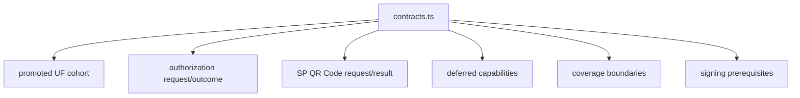

# src/canonical/nfce/contracts.ts

## Visao geral

Centraliza os contratos tipados do slice operacional de `NFC-e`, incluindo o cohort promovido `SP + PR`, os boundaries explicitos e o helper paulista de `QR Code` que permanece menor que o cohort de autorizacao.

## Responsabilidades

- Definir os tipos publicos e internos usados por `authorizeNFCe`.
- Definir o request, o resultado e a resposta publica do helper `generateNFCeSPQRCode`.
- Publicar a fonte unica de verdade do cohort promovido de `UFs`.
- Declarar as capabilities deferidas e as dependencias preparatorias do slice.
- Padronizar outcomes, boundaries e falhas de validacao do recorte atual.

## Entradas e saidas

- Entradas: nenhuma em runtime direto; o modulo e consumido por outros modulos do slice.
- Saidas: tipos, interfaces e helpers como `getNFCePromotedUFCohort`, `getNFCeDeferredCapabilities`, `getNFCeSigningPrerequisiteDependencies`, `NFCeSPQRCodeRequest` e `NFCeSPQRCodeResponse`.

## Fluxo principal



## Tratamento de erros e casos-limite

- O modulo nao executa IO nem transporte.
- O cohort promovido permanece fechado em `SP` e `PR`.
- O helper de `QR Code` continua mais restrito que o cohort promovido e aceita apenas `SP`.
- Capabilities auxiliares continuam explicitamente fora do runtime imediato.

## Exemplos

```ts
import { getNFCePromotedUFCohort, type NFCeSPQRCodeRequest } from './contracts.js';

const promotedUfs = getNFCePromotedUFCohort();

const request: NFCeSPQRCodeRequest = {
  accessKey: '35260512345678000123650010000001231123456781',
  csc: { cscId: '000001', cscToken: 'TOKEN-H-EXAMPLE-123' },
  environment: 'homologation',
  uf: 'SP',
};
```

## Dependencias e integracoes

- `authorize-nfce.ts`
- `generate-nfce-sp-qr-code.ts`
- `coverage-boundary.ts`
- `select-nfce-profile.ts`
- `prepare-signing-prerequisites.ts`
