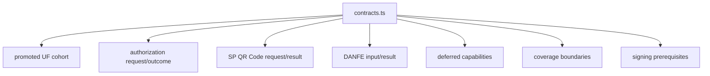

# src/canonical/nfce/contracts.ts

## Visao geral

Centraliza os contratos tipados da autorizacao de `NFC-e`, do cohort homologado `SP + PR`, da producao SP modelo 65, do helper paulista de `QR Code` e do renderer DANFE.

## Responsabilidades

- Definir os tipos publicos e internos usados por `authorizeNFCe`.
- Definir o request, o resultado e a resposta publica do helper `generateNFCeSPQRCode`.
- Definir entradas e resultados do renderer para evidência autorizada e registro offline pendente.
- Publicar a fonte unica de verdade do cohort promovido de `UFs`.
- Declarar as capabilities deferidas e as dependencias preparatorias do slice.
- Padronizar outcomes, boundaries e falhas de validacao do recorte atual.
- Definir `csc`, `unsignedXml`, `qrCodeUrl` e a acao condicional de reconciliacao como campos aditivos da autorizacao.

## Entradas e saidas

- Entradas: nenhuma em runtime direto; o modulo e consumido por outros modulos do slice.
- Saidas: tipos, interfaces e helpers como `getNFCePromotedUFCohort`, `getNFCeDeferredCapabilities`, `NFCeSPQRCodeRequest`, `RenderNFCeSPDANFEInput` e `NFCeSPDanfeResult`.

## Fluxo principal



## Tratamento de erros e casos-limite

- O modulo nao executa IO nem transporte.
- O cohort promovido permanece fechado em `SP` e `PR`.
- O helper de `QR Code` continua mais restrito que o cohort homologado e aceita apenas `SP`.
- A producao exige `unsignedXml`; a homologacao existente continua aceitando requests sem `csc` ou XML assinado.
- O XML de producao precisa ter CNPJ ou CPF do emitente coerente com as 14 posicoes fiscais da chave de acesso.
- `NFCeAuthorizationOutcome.nextAction` pode indicar `reconcileNFeReceipt` quando a resposta estiver `received` e houver recibo; a facade nao consulta o recibo automaticamente.
- O token bruto de `CSC` e uma entrada transitória e nunca compoe o outcome.
- O preparo offline exige evidência do calendário do integrador, valida dias consecutivos e confere o encerramento do primeiro dia útil; a autoridade da fonte permanece externa.
- Resultados de reconciliação usam `authorized`, `deadline-expired`, `duplicate`, `inconclusive`, `received`, `rejected`, `timeout` e `unavailable`; `operatorActionRequired` permanece um booleano separado.
- Capabilities auxiliares continuam explicitamente fora do runtime imediato.
- O renderer recebe `NFCeAuthorizationOutcome` ou `NFCeSPOfflineRecord` e rejeita evidências ausentes ou divergentes.
- O resultado autorizado comunica protocolo e digest do envelope SOAP; o resultado offline declara pendência e não inclui protocolo.

## Exemplos

```ts
import { getNFCePromotedUFCohort, type NFCeSPQRCodeRequest } from './contracts.js';

const promotedUfs = getNFCePromotedUFCohort();

const request: NFCeSPQRCodeRequest = {
  accessKey: '35260512345678000123650010000001231123456781',
  csc: { cscId: '000001', cscToken: 'TOKEN-H-EXAMPLE-123' },
  environment: 'homologation',
  uf: 'SP',
};
```

Em producao, `NFCeAuthorizationRequest` tambem precisa de `unsignedXml`, `csc`, `requestExecutor` e `signingContext`. A resposta adiciona `qrCodeUrl` apenas para uma autorizacao confirmada.

## Dependencias e integracoes

- `authorize-nfce.ts`
- `generate-nfce-sp-qr-code.ts`
- `coverage-boundary.ts`
- `select-nfce-profile.ts`
- `prepare-signing-prerequisites.ts`
- `render-nfce-sp-danfe.ts`
