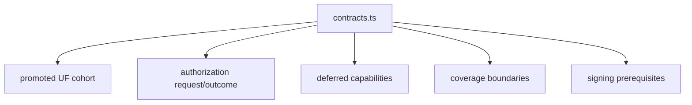

# src/canonical/nfce/contracts.ts

## Visao geral

Centraliza os contratos tipados do slice operacional de `NFC-e`, incluindo o cohort promovido `SP + PR`, os boundaries explicitos e as dependencias auxiliares que continuam fora do runtime.

## Responsabilidades

- Definir os tipos publicos e internos usados por `authorizeNFCe`.
- Publicar a fonte unica de verdade do cohort promovido de `UFs`.
- Declarar as capabilities deferidas e as dependencias preparatorias do slice.
- Padronizar outcomes, boundaries e falhas de validacao do recorte atual.

## Entradas e saidas

- Entradas: nenhuma em runtime direto; o modulo e consumido por outros modulos do slice.
- Saidas: tipos, interfaces e helpers como `getNFCePromotedUFCohort`, `getNFCeDeferredCapabilities` e `getNFCeSigningPrerequisiteDependencies`.

## Fluxo principal



## Tratamento de erros e casos-limite

- O modulo nao executa IO nem transporte.
- O cohort promovido permanece fechado em `SP` e `PR`.
- Capabilities auxiliares continuam explicitamente fora do runtime imediato.

## Exemplos

```ts
import { getNFCePromotedUFCohort } from './contracts.js';

const promotedUfs = getNFCePromotedUFCohort();
```

## Dependencias e integracoes

- `authorize-nfce.ts`
- `coverage-boundary.ts`
- `select-nfce-profile.ts`
- `prepare-signing-prerequisites.ts`
