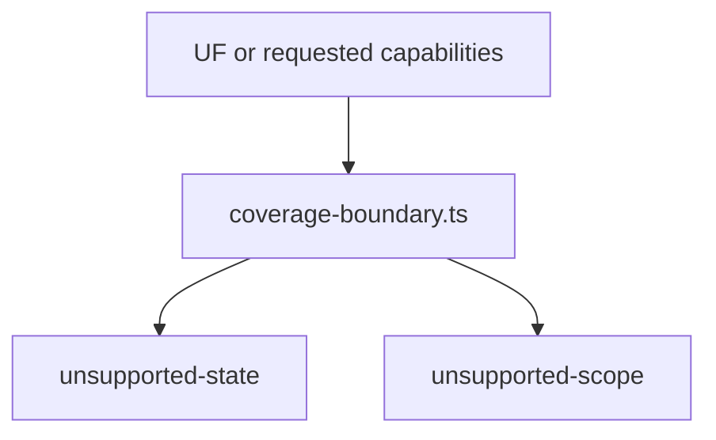

# src/canonical/nfce/coverage-boundary.ts

## Visao geral

Constroi os payloads publicos de boundary usados pelo slice operacional de `NFC-e` para bloquear `UFs` fora do cohort promovido e capabilities auxiliares ainda deferidas.

## Responsabilidades

- Emitir `unsupported-state` para `UFs` fora do cohort `SP + PR`.
- Emitir `unsupported-scope` para `CSC`, `QR Code`, `DANFE NFC-e`, contingencia e demais capabilities nao promovidas.
- Manter mensagens e codigos estaveis para contrato, testes e documentacao.

## Entradas e saidas

- Entradas: `uf` inferida ou `requestedCapabilities` deferidas.
- Saidas: `NFCeCoverageBoundary` e `NFCeAuthorizationOutcome` bloqueados antes do transporte.

## Fluxo principal



## Tratamento de erros e casos-limite

- O modulo nao faz IO.
- A mensagem de `unsupported-state` deriva do cohort promovido centralizado em `contracts.ts`.
- A classificacao de scope deferido continua separando runtime de backlog auxiliar.
- `offline-contingency` permanece nomeada explicitamente como capability deferida, mesmo depois da promocao observavel de `SVC` em `NF-e`.

## Exemplos

```ts
const boundary = createUnsupportedStateNFCeCoverageBoundary('RJ');
```

## Dependencias e integracoes

- `contracts.ts`
- `authorize-nfce.ts`
- `resolve-nfce-uf.ts`
