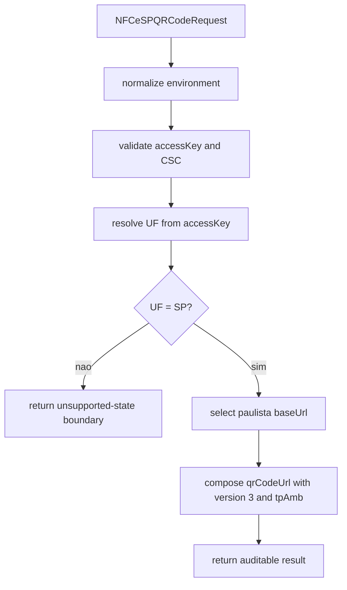

# src/canonical/nfce/generate-nfce-sp-qr-code.ts

## Visao geral

Gera o resultado local do `QR Code` oficial da `NFC-e` paulista para `homologation` e `production`, sem abrir transporte, renderer visual ou rollout multi-`UF`.

## Responsabilidades

- Validar `accessKey`, `CSC`, ambiente e coerencia entre `uf` e a chave.
- Selecionar a `baseUrl` paulista correta para `homologation` ou `production`.
- Compor a URL final do `QR Code` na forma online da versao `3`.
- Devolver `unsupported-state` explicita quando a requisicao nao pertencer a `SP`.

## Entradas e saidas

- Entradas: `NFCeSPQRCodeRequest`.
- Saidas: `NFCeSPQRCodeResponse`, que pode ser um resultado bem-sucedido ou uma boundary `unsupported-state`.

## Fluxo principal



## Tratamento de erros e casos-limite

- Falha com `NFCeOperationalUsageError` quando `accessKey` nao tem 44 digitos, nao corresponde ao modelo `65`, ou quando `uf` diverge da chave.
- Falha com `NFCeOperationalUsageError` quando `cscId` ou `cscToken` chegam vazios.
- Retorna `unsupported-state` para `PR` e qualquer `UF` fora de `SP`.
- Nao devolve o token bruto de `CSC` em nenhuma resposta.

## Exemplos

```ts
const result = generateNFCeSPQRCode({
  accessKey: '35260512345678000123650010000001231123456781',
  csc: { cscId: '000001', cscToken: 'TOKEN-H-EXAMPLE-123' },
  environment: 'homologation',
  uf: 'SP',
});
```

## Dependencias e integracoes

- `../shared/environment-rule.js`
- `./contracts.js`
- `./coverage-boundary.js`
- `./prepare-signing-prerequisites.js`
- `./resolve-nfce-uf.js`