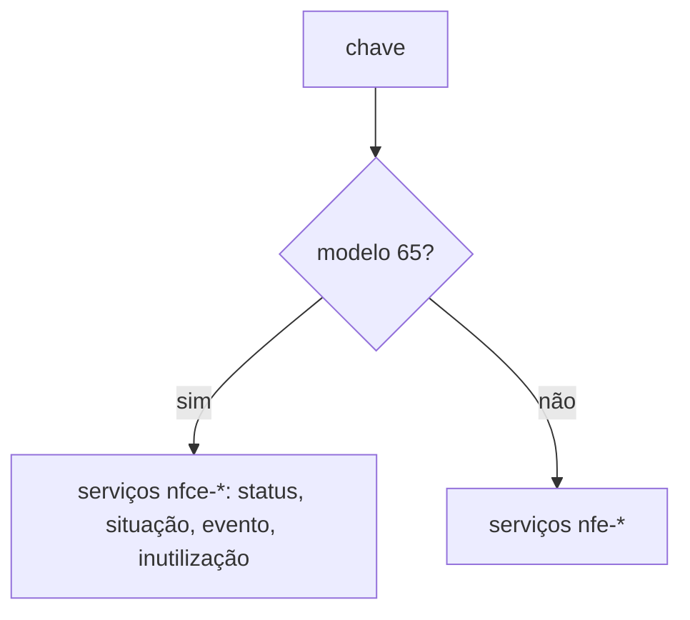

# nfce-lifecycle-rules

## Visão geral

Regras do ciclo de vida da NFC-e (modelo 65) compartilhadas pelos caminhos de consulta, evento e inutilização do SDK.

## Responsabilidades

- `isNfceAccessKey`: reconhece a chave de 44 dígitos do modelo 65 (dígitos 21 e 22 iguais a `65`).
- `validateSubstitution`: valida o cancelamento por substituição (evento 110112) antes de assinar: só NFC-e, `substituteAccessKey` de outra NFC-e e `applicationVersion` (`verAplic`) de 1 a 20 caracteres.
- `isInutilizationDispensed`: SP (35), AC (12) e BA (29) dispensam o pedido de inutilização da NFC-e desde 2026-11-01; nenhuma requisição é enviada.

## Entradas e saídas

```ts
nfceRules.isNfceAccessKey(key): boolean
nfceRules.validateSubstitution(accessKey, event): string | undefined
nfceRules.isInutilizationDispensed('35'): boolean
```

## Fluxo principal



## Tratamento de erros e casos-limite

As funções devolvem o primeiro problema como texto (`usage-error` no resultado público); nada é assinado nem enviado quando há problema.

## Exemplos

```ts
nfceRules.validateSubstitution(chave65, { ...evento, substituteAccessKey: outraChave65, applicationVersion: 'app 1.0' }); // undefined
```

## Dependências e integrações

Usado por `nfe-signed-event`, `wire-document-situation` e pelo roteamento de inutilização.
