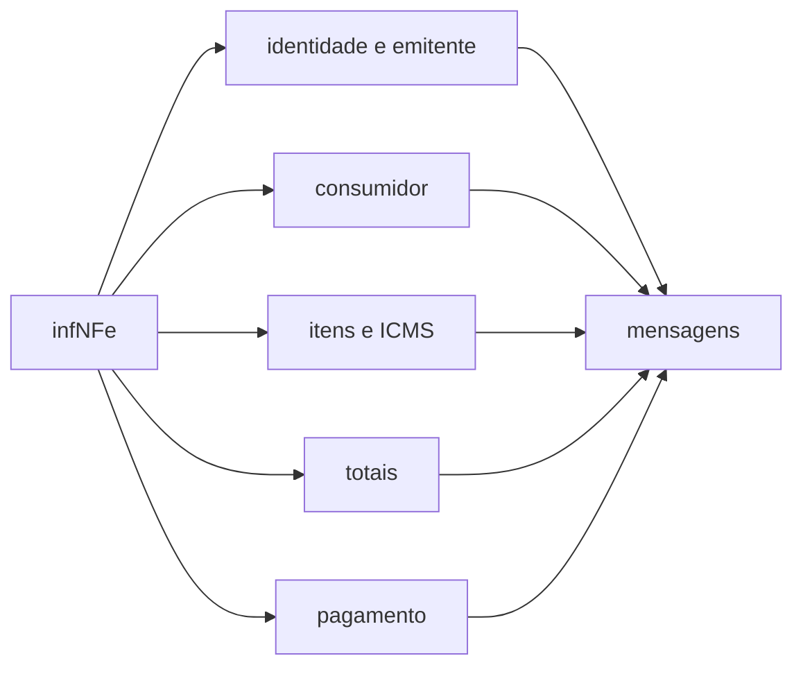

# src/canonical/nfce/nfce-model-rules.ts

## Visao geral

Regras de validacao do modelo 65 (`NFC-e`) do MOC 7.0 Anexo I, aplicadas ao rascunho antes de assinar ou enviar. Cada mensagem traz o caminho do campo e o codigo de rejeicao da SEFAZ que antecipa.

## Responsabilidades

- Identificacao e emitente: sem `dhSaiEnt` (705) nem documento referenciado (708); serie de 0 a 889 para CNPJ e de 920 a 969 para CPF (244, 503); sem IE de substituto tributario (718).
- Consumidor: opcional, mas obrigatorio acima de R$ 10.000,00 (750) e na entrega a domicilio (787); `indIEDest` 9 (789), sem IE (729), sem SUFRAMA (730), CNPJ diferente do emitente (220).
- Itens: `indTot` 1 (774); CFOP 5101, 5102, 5103, 5104, 5115, 5405, 5656, 5667 e 5933 (725); ISSQN so no 5933 (374); NCM de 8 digitos (777); descricao do primeiro item em homologacao (373); desconto ate o valor do produto (483); sem veiculo, arma, IPI, II, PIS ST, COFINS ST, ICMS UF destino e devolucao de tributos (736, 738, 746, 749, 742, 743, 807, 390).
- ICMS: CST 00, 20, 40, 41 e 60; CSOSN 102, 103, 300, 400 e 500 (766, 383). CST 90 e CSOSN 900 dependem da UF e ficam recusados.
- Totais: ate R$ 200.000,00 (780) e `vProd` igual a soma dos itens (531). Grupos `exporta`, `compra` e `cana` recusados (814, 762, 763).
- Pagamento: sem duplicata (857), sem pagamento (899) e sem outros (436); cartao e PIX exigem o grupo de cartao (391); soma igual ao total (865) e troco igual a diferenca quando maior (866).
- `getNFCeAcceptedFiscalCodes()` expoe as listas de CFOP, CST e CSOSN aceitos.

## Entradas e saidas

`validateNFCeModelRules(infNFe)` recebe o conteudo de `infNFe` e devolve uma lista de mensagens (vazia quando nada e violado). `getNFCeAcceptedFiscalCodes()` devolve copias independentes das listas.

## Fluxo principal



## Tratamento de erros e casos-limite

Valores que nao sao decimais de ate duas casas sao ignorados nas somas (o XSD ja os recusa). Compatibilidade entre CST/CSOSN e CFOP (766, 382, 386) e as regras de datas (703, 704) nao sao verificadas aqui. A SEFAZ continua sendo a autoridade final.

## Exemplos

```ts
const issues = validateNFCeModelRules(draft.infNFe);
const { cfop } = getNFCeAcceptedFiscalCodes();
```

## Dependencias e integracoes

Chamada por [buildNFCeDocument](./build-nfce-document.doc.md); `getNFCeAcceptedFiscalCodes` e exportada pela raiz do pacote.
