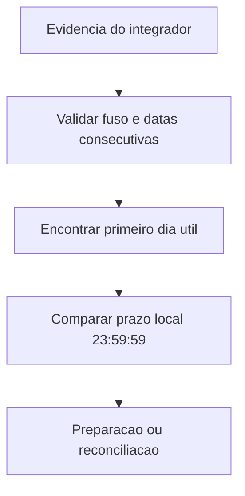

# offline-business-calendar.ts

## Visao geral

Valida a evidência de calendário informada pelo integrador para a contingência offline de NFC-e SP. O módulo confere a estrutura e a coerência temporal sem carregar regras próprias de feriados.

## Responsabilidades

- Exigir um identificador de calendário e um fuso IANA válido.
- Conferir datas consecutivas desde o dia seguinte à emissão até o primeiro dia marcado como útil.
- Confirmar que o prazo corresponde a 23:59:59 desse dia no fuso informado.
- Rejeitar evidência incompleta ou prazo incompatível antes do preparo e da reconciliação.

## Entradas e saídas

- Entradas: evidência de calendário, timestamp de emissão e prazo de transmissão.
- Saída: nenhuma; a função retorna normalmente quando a evidência é consistente.
- Erros: `NFCeOperationalUsageError` para evidência inválida ou prazo divergente.

## API / Assinatura

```ts
validateNFCeSPOfflineBusinessCalendar(
  evidence: NFCeSPOfflineBusinessCalendarEvidence,
  issuedAt: string,
  submissionDeadline: string,
): void
```

## Fluxo principal



## Tratamento de erros e casos-limite

- Datas ausentes, inválidas, fora de sequência ou posteriores ao primeiro dia útil invalidam a evidência.
- O calendário deve cobrir pelo menos um dia útil após a emissão.
- O módulo não confirma se `calendarId` é oficial nem se a classificação de feriados fornecida é verdadeira; essa autoridade permanece com o integrador.

## Exemplos

```ts
validateNFCeSPOfflineBusinessCalendar(
  {
    calendarId: 'calendario-fiscal',
    timeZone: 'America/Sao_Paulo',
    evaluatedDates: [{ date: '2026-12-03', isBusinessDay: true }],
  },
  '2026-12-02T10:00:00-03:00',
  '2026-12-03T23:59:59-03:00',
);
```

## Dependências e integrações

- Contratos tipados em `contracts.ts`.
- Erro de uso operacional em `errors.ts`.
- Consumido internamente por `prepare-nfce-sp-offline.ts` e `reconcile-nfce-sp-offline.ts`.