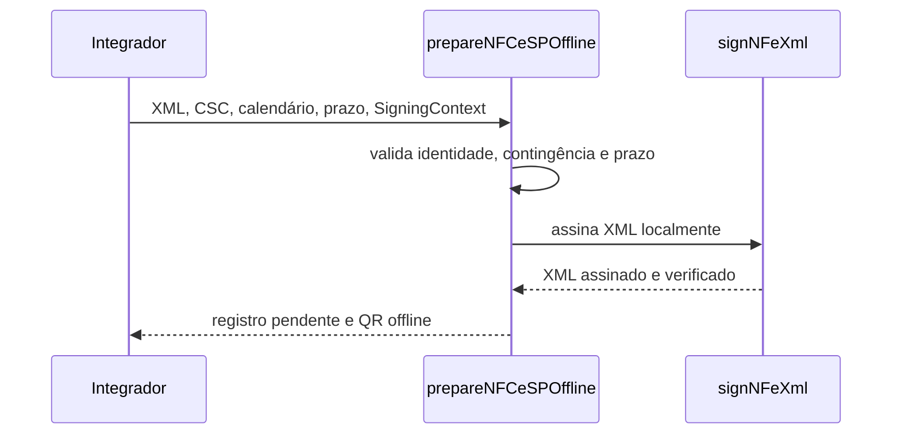

# prepare-nfce-sp-offline.ts

## Visão geral

Prepara uma NFC-e paulista modelo 65 para contingência offline, valida os campos oficiais, assina o XML localmente e retorna um registro explicitamente pendente de autorização.

## Responsabilidades

- Confirmar identidade SP/modelo 65, ambiente, `tpEmis=9` e campos de contingência.
- Exigir a justificativa no limite definido pelo XSD NFC-e v4.00.
- Assinar e verificar o XML sem abrir transporte.
- Calcular o QR Code offline v2 e o SHA-256 do XML assinado sem devolver o token CSC.
- Validar a evidência de calendário fornecida pelo integrador e registrar o prazo do primeiro dia útil seguinte.

## Entradas e saídas

- Entrada: `PrepareNFCeSPOfflineInput`, contendo XML não assinado, CSC, ambiente, `SigningContext`, evidência de calendário e prazo.
- Saída: `NFCeSPOfflineRecord` com XML assinado, chave, digest, evidência, URL QR e estado `pending-reconciliation`.

## API / Assinatura

```ts
prepareNFCeSPOffline(input: PrepareNFCeSPOfflineInput): Promise<NFCeSPOfflineRecord>
```

## Fluxo principal



## Tratamento de erros e casos-limite

- XML malformado, chave divergente, UF/modelo/ambiente incorretos ou `tpEmis` diferente de `9` geram `NFCeOperationalUsageError`.
- `dhCont`, `xJust`, campos exigidos pelo MOC, evidência de calendário incompleta, prazo diferente de 23:59:59 no primeiro dia útil seguinte ou CSC inválido são rejeitados antes do retorno.
- A preparação não transmite o documento e não afirma que a SEFAZ autorizou a NFC-e.
- O SDK verifica a sequência de datas e o fuso IANA declarado; a origem oficial do calendário continua sob responsabilidade do integrador.

## Exemplos

```ts
const record = await prepareNFCeSPOffline({
  csc: { cscId: '000002', cscToken: process.env.NFCE_CSC_TOKEN! },
  businessCalendarEvidence: {
    calendarId: 'calendario-fiscal-da-aplicacao',
    timeZone: 'America/Sao_Paulo',
    evaluatedDates: [{ date: '2026-12-03', isBusinessDay: true }],
  },
  environment: 'production',
  signingContext,
  submissionDeadline: '2026-12-03T23:59:59-03:00',
  unsignedXml,
});
```

## Dependências e integrações

- `signNFeXml` para assinatura/verificação local.
- Manual Offline NFC-e v2.0, MOC 7.0 Annex IV e XSD NFC-e v4.00 para limites fiscais.
- Manual DANFE NFC-e/QR Code v6.0 seções 4.3.2 e 4.3.5 para URL/hash do QR offline.
- O integrador retém o registro e fornece a evidência do calendário aplicável; o SDK não autentica sua fonte.