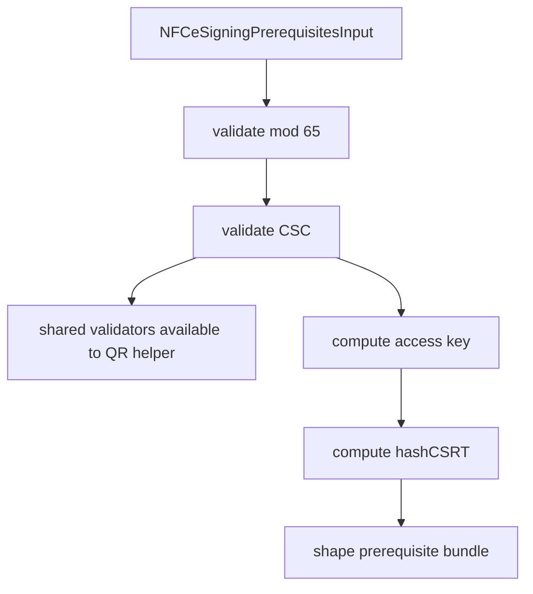

# src/canonical/nfce/prepare-signing-prerequisites.ts

## Visao geral

Prepara os identificadores de assinatura de `NFC-e` sem abrir transporte, `QR Code` ou autorizacao completa.

## Responsabilidades

- Validar o boundary minimo de `NFC-e` (`mod` igual a `65`).
- Exigir `CSC` e `CSRT` nao vazios antes do calculo.
- Expor validacoes reutilizaveis de `mod` `65` e `CSC` para manter o helper paulista de `QR Code` alinhado ao mesmo contrato local.
- Reaproveitar os helpers de `chNFe`, `cDV` e `hashCSRT` para montar um bundle preparatorio coerente.
- Permanecer coerente com o cohort operacional `SP + PR` sem transformar precondicoes em promessa de autorizacao completa.

## Entradas e saidas

- Entradas: `NFCeSigningPrerequisitesInput`.
- Saidas: `NFCeSigningPrerequisitesResult`.

## Fluxo principal



## Tratamento de erros e casos-limite

- Rejeita modelos diferentes de `65`.
- Falha quando `cscId` ou `cscToken` chegam vazios.
- As validacoes compartilhadas continuam locais e nao persistem segredos nem assumem administracao de `CSC`.
- Propaga a validacao do helper de `hashCSRT` quando `CSRT` ou `CNPJ` sao invalidos.
- Nao sugere que o bundle retornado equivalha a autorizacao, `QR Code` ou `DANFE NFC-e` concluido.
- Continua servindo tanto ao piloto `SP` quanto ao cohort promovido `PR`, sem alterar a lista de dependencias deferidas.

## Exemplos

```ts
const prerequisites = prepareNFCeSigningPrerequisites({
  accessKeyFields,
  csc,
  hashCsrtInput,
});
```

## Dependencias e integracoes

- `../nfe/access-key.js`
- `../nfe/hash-csrt.js`
- `./contracts.js`
- `./errors.js`
- `./generate-nfce-sp-qr-code.ts`