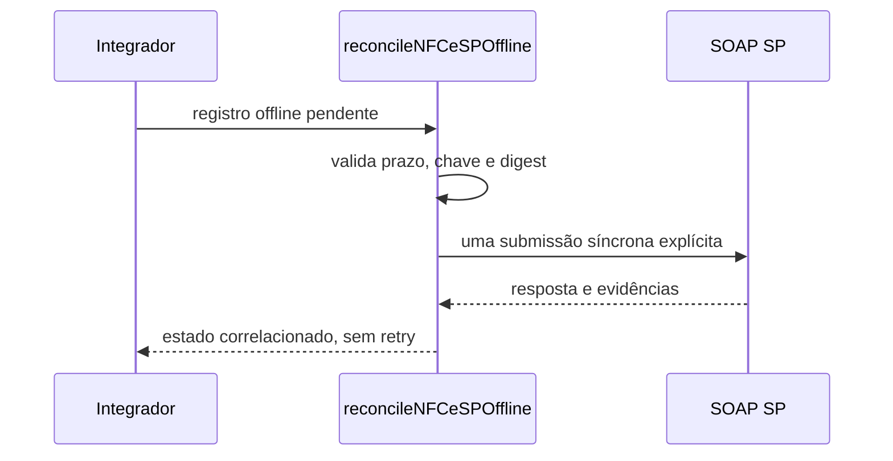

# reconcile-nfce-sp-offline.ts

## Visão geral

Envia uma única NFC-e paulista previamente assinada em contingência offline e devolve um resultado correlacionado à chave e ao digest originais.

## Responsabilidades

- Validar estado, identidade fiscal e SHA-256 do registro antes do transporte.
- Impedir envio depois do prazo fornecido pelo integrador.
- Executar uma chamada SOAP explícita, sem retry ou polling automático.
- Retornar uma das classificações `authorized`, `deadline-expired`, `duplicate`, `inconclusive`, `received`, `rejected`, `timeout` ou `unavailable`.
- Informar separadamente `operatorActionRequired`, preservando classificações específicas como duplicidade e timeout.
- Preservar evidência do transporte e o digest do XML para persistência do integrador.

## Entradas e saídas

- Entrada: `ReconcileNFCeSPOfflineInput` com registro pendente e executor de transporte opcional.
- Saída: `NFCeSPOfflineReconciliationResult` associado à mesma chave e ao SHA-256 submetido.

## API / Assinatura

```ts
reconcileNFCeSPOffline(input: ReconcileNFCeSPOfflineInput): Promise<NFCeSPOfflineReconciliationResult>
```

## Fluxo principal



## Tratamento de erros e casos-limite

- Registro alterado ou inconsistente lança `NFCeOperationalUsageError` antes do transporte.
- Prazo vencido retorna `deadline-expired` e não chama a SEFAZ.
- Resposta `103` retorna `received` com `operatorActionRequired: false`, nunca `authorized`; respostas `100` só autorizam quando chave, ambiente, status e protocolo coincidem.
- Códigos conhecidos de duplicidade retornam `duplicate`; timeout, indisponibilidade, prazo expirado e resultados inconclusivos mantêm classificações próprias e exigem ação do chamador.
- O chamador persiste tentativas e impede replay concorrente ou obsoleto entre chamadas/processos.

## Exemplos

```ts
const result = await reconcileNFCeSPOffline({
  offlineRecord,
  requestExecutor,
});
```

## Dependências e integrações

- `executeNFeSoapService` e o catálogo existente do autorizador NFC-e SP.
- Manual Offline NFC-e, MOC Annex IV e contrato público `specs/029-nfce-sp-offline/contracts/public-nfce-sp-offline.md`.
- Persistência, prazo com calendário oficial e controle de concorrência pertencem ao integrador.