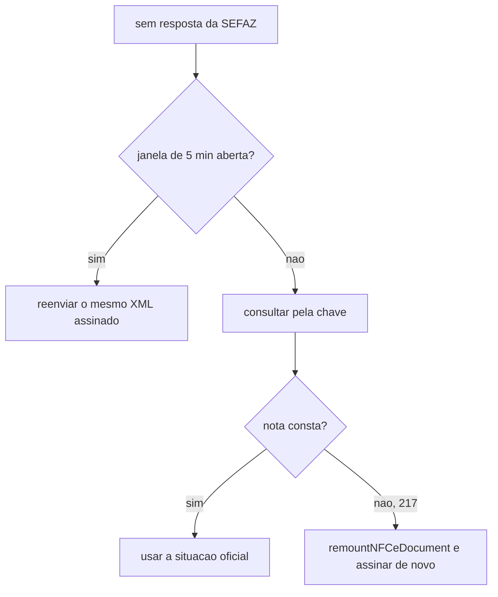

# src/canonical/nfce/remount-nfce-document.ts

## Visao geral

Apoio ao reenvio da NFC-e que a SEFAZ nunca recebeu: define a janela de 5 minutos em que o mesmo XML assinado ainda pode ser reenviado e remonta o documento depois dela.

## Responsabilidades

- `isNFCeResendWindowOpen(dhEmi, now)`: informa se ainda cabe reenviar o mesmo XML assinado (ate 5 minutos da emissao, rejeicao 704). Data ilegivel conta como janela fechada, para o documento ser consultado antes.
- `remountNFCeDocument(input, { dhEmi, cNF? })`: mesmo numero e serie, nova `dhEmi` e novo `cNF`, logo nova chave de acesso. Recusa `dhEmi` nao posterior a original e `cNF` igual ao anterior; sorteia o `cNF` quando nao informado, sempre diferente do anterior.
- Reaplica todas as regras da NFC-e via `buildNFCeDocument`; o rascunho de entrada nao e alterado.

## Entradas e saidas

Entrada: rascunho `NFCeDocumentInput` e `RemountNFCeOptions`. Saida: `BuiltNFCeDocument` nao assinado (assinar de novo). Falha: `BuildNFCeDocumentError`.

## API / Assinatura

```ts
export function isNFCeResendWindowOpen(dhEmi: string, now?: Date): boolean;
export function remountNFCeDocument(input: NFCeDocumentInput, options: RemountNFCeOptions): BuiltNFCeDocument;
```

## Fluxo principal



## Tratamento de erros e casos-limite

A chave perdida ou rejeitada nunca e reutilizada. Na contingencia offline a remontagem mantem `tpEmis` 9. A decisao de consultar, reenviar ou remontar e do chamador; estas funcoes so oferecem a janela e a remontagem.

## Exemplos

```ts
if (!isNFCeResendWindowOpen(dhEmi)) {
  const rebuilt = remountNFCeDocument(draft, { dhEmi: new Date().toISOString() });
}
```

## Dependencias e integracoes

[buildNFCeDocument](./build-nfce-document.doc.md); exportadas pela raiz do pacote e listadas em `publicPackageContract`.
