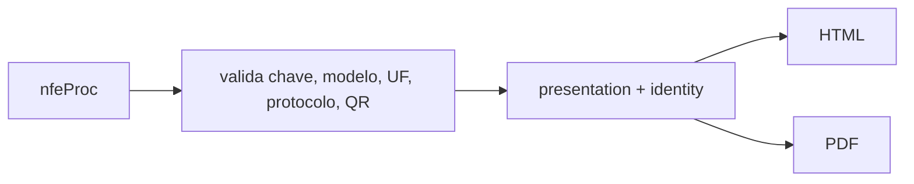

# render-nfce-sp-danfe-authorized-projection

## Visão geral

Valida o `nfeProc` autorizado de uma NFC-e de SP e projeta o conteudo fiscal do DANFE. E a unica fonte das regras usadas pelo DANFE em HTML e pelo DANFE em PDF.

## Responsabilidades

- Exigir `nfeProc` com uma NFe de SP, modelo 65, chave valida em `infNFe/@Id`.
- Exigir `protNFe/infProt` com a mesma chave e o mesmo `tpAmb`, e `cStat` 100 ou 150.
- Compor o QR Code versao 3; `infNFeSupl/qrCode`, se presente, deve ser exatamente essa URL.
- Calcular o SHA-256 do XML e projetar os campos de `NFCePresentation`.

## Entradas e saídas

```ts
projectAuthorizedNFCeXml(authorizedXml: string): {
  presentation: NFCePresentation;
  identity: AuthorizedNFCeIdentity; // accessKey, authorizedXmlSha256, environment, protocolNumber, qrCodeUrl
}
```

## Fluxo principal



## Tratamento de erros e casos-limite

`NFCeOperationalUsageError` com o motivo (XML malformado, nao SP, nao modelo 65, protocolo divergente, QR Code divergente).

## Exemplos

```ts
const { presentation, identity } = projectAuthorizedNFCeXml(authorizedXml);
```

## Dependências e integrações

`render-nfce-sp-danfe-projection`, `render-nfce-sp-danfe-support`, `render-nfce-sp-danfe-xml`, `resolve-nfce-qr-code-endpoint`.
