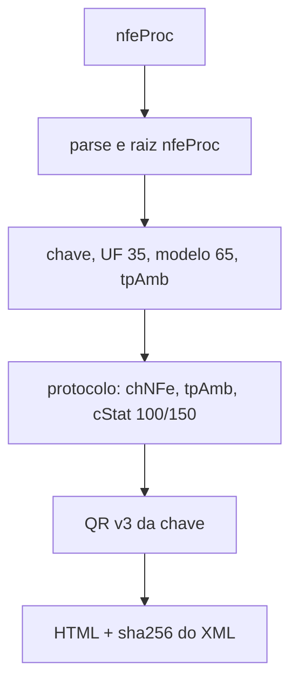

# render-nfce-sp-danfe-authorized-xml

## Visão geral

Caminho do `renderNFCeSPDANFE` que desenha o DANFE a partir do `nfeProc` autorizado (NFe assinada mais `protNFe`), o artefato legal que o integrador guarda, sem exigir a evidencia SOAP capturada.

## Responsabilidades

- Validar que o documento e um `nfeProc` com uma unica NFe de SP, modelo 65, com a chave de `infNFe/@Id` valida (44 digitos e digito verificador).
- Exigir `protNFe/infProt` com `chNFe` igual a chave, `tpAmb` igual ao da NFe e `cStat` 100 ou 150 (autorizacao dentro ou fora do prazo).
- Compor o QR Code versao 3 da chave e do ambiente; se a NFe trouxer `infNFeSupl/qrCode`, ele precisa ser exatamente essa URL.
- Devolver HTML autocontido, a identidade e o SHA-256 do XML renderizado (`authorizedXmlSha256`, tambem presente no HTML).

## Entradas e saídas

```ts
renderNFCeSPDANFE({ authorizedXml, paperWidthMm?: 56..210 }): Promise<NFCeSPAuthorizedXmlDanfeResult>
```

`copy: 'establishment'` e recusado, como em qualquer documento autorizado.

## Fluxo principal



## Tratamento de erros e casos-limite

Qualquer inconsistencia lanca `NFCeOperationalUsageError`: XML malformado, raiz diferente de `nfeProc`, ausencia de protocolo, protocolo de outra chave ou ambiente, status que nao autoriza, UF diferente de SP, modelo diferente de 65 e QR Code divergente.

## Exemplos

```ts
const { html, protocolNumber } = await renderNFCeSPDANFE({ authorizedXml, paperWidthMm: 58 });
```

## Dependências e integrações

[render-nfce-sp-danfe-support](./render-nfce-sp-danfe-support.doc.md), projecao e HTML do DANFE, `SP_QR_CODE_BASE_URLS`.
