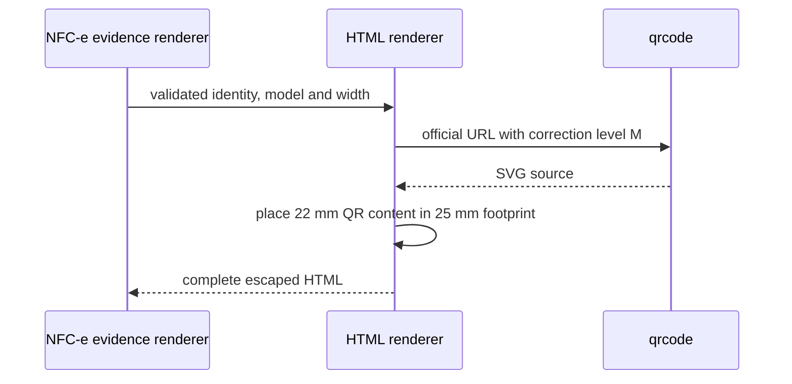

# Renderizador HTML DANFE NFC-e SP

## Visao geral

O modulo converte o modelo fiscal interno e a identidade de autorizacao validada em HTML autocontido. O documento inclui estilos responsivos e de impressao e um QR Code SVG gerado localmente.

## Responsabilidades

- Escapar todos os valores textuais antes de inseri-los no markup.
- Renderizar emissor, consumidor, entrega, itens, totais, pagamentos, chave e protocolo.
- Marcar cada artigo de item como bloco individual para validacao geometrica.
- Gerar o QR Code a partir da URL oficial validada, com correcao M e footprint de 25 mm.
- Aplicar a largura de papel ja validada pelo chamador.
- Incluir a advertencia de homologacao quando o ambiente for homologacao.

## Entradas e saidas

- Entradas: modelo `NFCePresentation`, identidade correlacionada e largura em milimetros.
- Saida: string HTML completa, sem recursos remotos.
- Falha: rejeita se a biblioteca QR nao produzir um SVG reconhecivel.

## API / Assinatura

```ts
export default async function renderNFCeHtml(
  presentation: NFCePresentation,
  result: NFCeIdentity,
  paperWidthMm: number,
): Promise<string>;
```

## Fluxo principal



## Tratamento de erros e casos-limite

- Valores XML sao escapados para texto e atributos HTML.
- A URL QR ja deve estar correlacionada com a autorizacao antes de chegar ao modulo.
- O gerador exige dimensoes positivas e ao menos um elemento `path` no SVG.
- A largura de papel e validada pelo modulo orquestrador antes da chamada.

## Exemplos

```ts
const html = await renderNFCeHtml(presentation, identity, 80);
```

## Dependencias e integracoes

- `qrcode` para composicao SVG local, sem chamadas de rede.
- [Modelo interno da apresentacao](./render-nfce-sp-danfe-model.doc.md).
- Chamado por [renderNFCeSPDANFE](./render-nfce-sp-danfe.doc.md).
