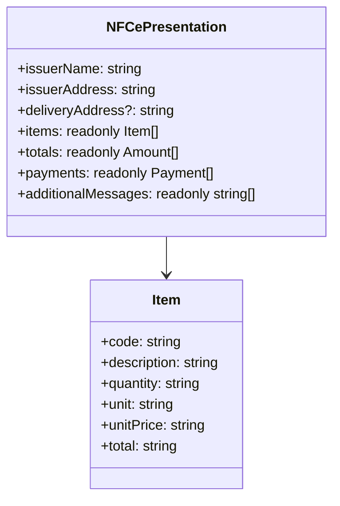

# Modelo de apresentacao DANFE NFC-e SP

## Visao geral

`NFCePresentation` descreve os campos fiscais projetados do XML autorizado para a composicao do HTML DANFE. O tipo e interno ao pacote e nao substitui o contrato fiscal nem os dados de autorizacao.

## Responsabilidades

- Delimitar os dados de emissor, consumidor, entrega, documento, itens, totais, pagamentos e mensagens fiscais.
- Compartilhar a mesma estrutura tipada entre a projecao XML e o renderizador HTML.

## Entradas e saidas

- Entrada: dados extraidos do XML NFC-e validado.
- Saida: contrato interno `NFCePresentation`, usado sem mutacao na renderizacao.

## API / Assinatura

```ts
export default interface NFCePresentation {
  readonly issuerName: string;
  readonly items: readonly {
    readonly code: string;
    readonly description: string;
    readonly quantity: string;
    readonly unit: string;
    readonly unitPrice: string;
    readonly total: string;
  }[];
}
```

O tipo completo tambem inclui identidade de exibicao, endereco, totais, pagamentos e mensagens adicionais.

## Fluxo principal



## Tratamento de erros e casos-limite

- Campos obrigatorios sao validados durante a projecao do XML, antes da criacao deste modelo.
- Valores monetarios e quantidades permanecem como strings para preservar a representacao fiscal recebida.
- Campos opcionais, como consumidor, endereco de entrega e troco, podem estar ausentes.

## Exemplos

```ts
const presentation: NFCePresentation = projectAuthorizedNFCe(xml, identity);
```

## Dependencias e integracoes

- Produzido pelo [renderizador de evidencia](./render-nfce-sp-danfe.doc.md).
- Consumido pelo [renderizador HTML](./render-nfce-sp-danfe-html.doc.md).
