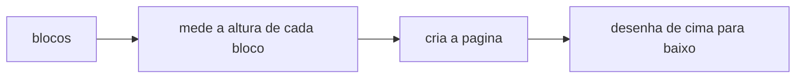

# render-nfce-sp-danfe-pdf-draw

## Visão geral

Desenha com `pdf-lib` os blocos do DANFE NFC-e numa unica pagina da largura do papel e da altura do conteudo (estilo bobina termica).

## Responsabilidades

- Fonte Helvetica (7,5 pt a partir de 70 mm; 6,5 pt abaixo), margem de 3 mm.
- Quebrar linhas pela largura; palavras longas (URL) sao quebradas por caractere.
- Trocar por `?` caracteres fora da codificacao da fonte (WinAnsi), para o desenho nunca falhar.
- QR Code da URL de consulta em PNG com 25 mm, como no HTML.
- Logotipo PNG ou JPEG (data URI) ate 18 mm de altura; outros formatos ficam de fora.

## Entradas e saídas

```ts
drawNFCeDanfePdf(blocks, { qrCodeUrl, paperWidthMm, logo? }): Promise<Uint8Array>
```

## Fluxo principal



## Tratamento de erros e casos-limite

Caracteres nao codificaveis viram `?`; logotipo GIF/WebP nao e desenhado.

## Exemplos

```ts
const pdf = await drawNFCeDanfePdf(blocks, { qrCodeUrl, paperWidthMm: 80 });
```

## Dependências e integrações

`pdf-lib`, `qrcode`.
