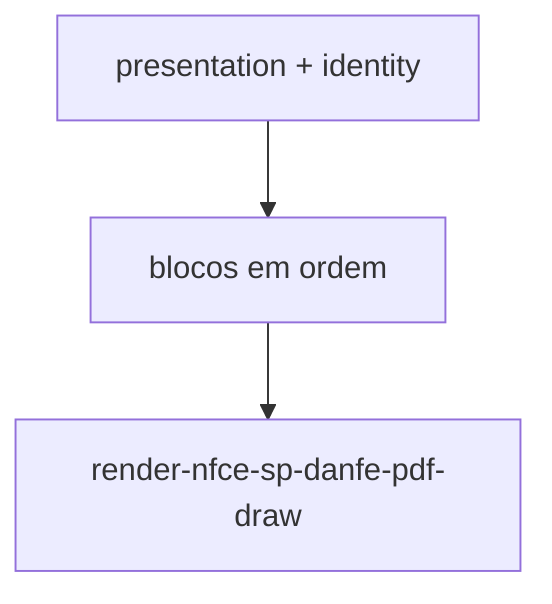

# render-nfce-sp-danfe-pdf-layout

## Visão geral

Monta, sem desenhar, os blocos imprimiveis do DANFE NFC-e em PDF, na ordem de impressao e com as mesmas secoes e textos legais do DANFE em HTML.

## Responsabilidades

- Aviso de homologacao (em homologacao), logotipo (quando houver), emitente, consumidor ou "CONSUMIDOR NÃO IDENTIFICADO", entrega, titulo, numero/serie e emissao.
- Itens (descricao, codigo, quantidade/unidade, valor unitario e total), totais, pagamento e troco.
- Consulta: chave formatada, protocolo e data de autorizacao, QR Code e URL de consulta.
- Informacoes adicionais.

## Entradas e saídas

```ts
layoutNFCeDanfe(presentation, identity, hasLogo): NFCeDanfeBlock[]
// blocos: text (align/bold), pair (rotulo + valor), rule, qr, logo
```

## Fluxo principal



## Tratamento de erros e casos-limite

Funcao pura, sem erros. Sem data de autorizacao, a linha do protocolo traz so o numero.

## Exemplos

```ts
const blocks = layoutNFCeDanfe(presentation, identity, false);
```

## Dependências e integrações

`render-nfce-sp-danfe-texts`.
