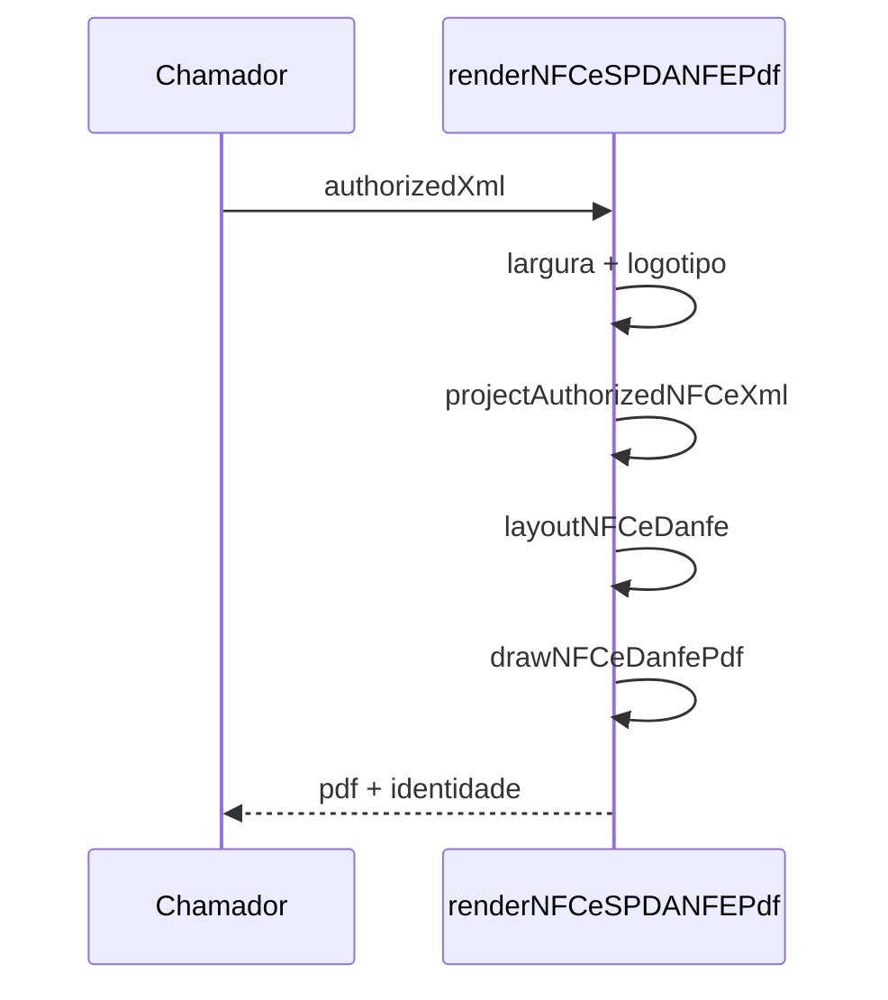

# render-nfce-sp-danfe-pdf

## Visão geral

`renderNFCeSPDANFEPdf`: DANFE NFC-e em PDF de uma NFC-e autorizada de SP, a partir do `nfeProc` guardado, com a mesma validacao, conteudo fiscal e textos legais do DANFE em HTML. Serve para baixar e enviar a nota ao consumidor (e-mail, WhatsApp).

## Responsabilidades

- Validar largura do papel (56–210 mm, padrao 80) e logotipo.
- Validar e projetar o XML ([render-nfce-sp-danfe-authorized-projection](render-nfce-sp-danfe-authorized-projection.ts)).
- Montar os blocos ([render-nfce-sp-danfe-pdf-layout](render-nfce-sp-danfe-pdf-layout.ts)) e desenhar ([render-nfce-sp-danfe-pdf-draw](render-nfce-sp-danfe-pdf-draw.ts)).

## Entradas e saídas

```ts
renderNFCeSPDANFEPdf({ authorizedXml, paperWidthMm?, logo? }): Promise<NFCeSPDanfePdfResult>
// { accessKey, authorizedXmlSha256, environment, pdf: Uint8Array, mediaType: 'application/pdf', protocolNumber }
```

## Fluxo principal



## Tratamento de erros e casos-limite

`NFCeOperationalUsageError` para XML que nao e NFC-e autorizada de SP, largura fora do intervalo ou logotipo invalido. So documento autorizado: o DANFE de contingencia offline continua em HTML (`renderNFCeSPDANFE` com `offlineRecord`).

## Exemplos

```ts
const { pdf } = await renderNFCeSPDANFEPdf({ authorizedXml });
```

## Dependências e integrações

`pdf-lib` (dependencia direta), `qrcode`.
