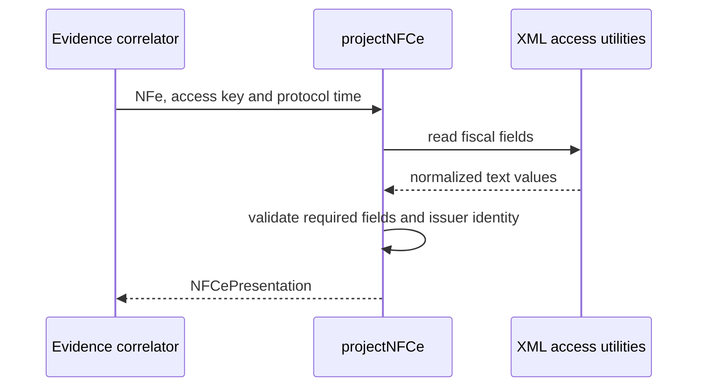

# Projecao fiscal DANFE NFC-e SP

## Visao geral

`projectNFCe` transforma um elemento XML `NFe` previamente correlacionado em campos tipados para o documento auxiliar. Nao determina se a nota foi autorizada.

## Responsabilidades

- Extrair e validar dados obrigatorios de emissor, endereco, itens, totais e pagamentos.
- Projetar o endereco de entrega quando o grupo `entrega` estiver presente.
- Preservar componentes aplicaveis dos totais, inclusive seguro (`vSeg`).
- Comparar o CNPJ ou CPF do emitente com o identificador fiscal da chave de acesso.
- Traduzir codigos de pagamento conhecidos sem perder o codigo em modalidades nao mapeadas.
- Preservar quantidades e valores como strings do XML.

## Entradas e saidas

- Entradas: elemento `NFe`, chave validada e data do protocolo de autorizacao.
- Saida: modelo interno `NFCePresentation`.
- Falhas de campos obrigatorios causam `NFCeOperationalUsageError`.

## API / Assinatura

```ts
export default function projectNFCe(
  nfe: XmlElement,
  accessKey: string,
  authorizationDate: string,
): NFCePresentation;
```

## Fluxo principal



## Tratamento de erros e casos-limite

- Emitente sem identificador ou com identificador divergente da chave e rejeitado.
- Cada item precisa conter todos os campos usados no DANFE.
- Exige ao menos um item, total a pagar e detalhe de pagamento.
- Consumidor, entrega, troco, complemento do endereco e informacoes adicionais sao opcionais.

## Exemplos

```ts
const presentation = projectNFCe(nfe, accessKey, authorizationDate);
```

## Dependencias e integracoes

- [Utilitarios XML internos](./render-nfce-sp-danfe-xml.doc.md).
- [Contrato interno](./render-nfce-sp-danfe-model.doc.md).
- Consumido por [renderNFCeSPDANFE](./render-nfce-sp-danfe.doc.md).
