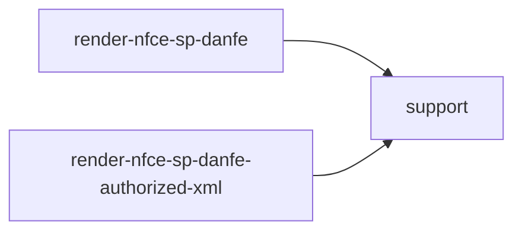

# render-nfce-sp-danfe-support

## Visão geral

Verificacoes de XML e de chave de acesso compartilhadas pelos caminhos de renderizacao do DANFE NFC-e.

## Responsabilidades

- `parseXml`: interpreta o XML e recusa documento malformado.
- `assertSoapEnvelope`: confere o envelope SOAP da evidencia capturada.
- `findExactlyOne`: exige exatamente um elemento do namespace da NF-e.
- `assertValidAccessKey`: chave de SP, modelo 65 e digito verificador.

## Entradas e saídas

Funcoes puras reunidas em um objeto exportado por padrao.

## Fluxo principal



## Tratamento de erros e casos-limite

Todas as recusas lancam `NFCeOperationalUsageError` com prefixo `renderNFCeSPDANFE`.

## Exemplos

```ts
support.assertValidAccessKey('35260512345678000123650020000004561876543219');
```

## Dependências e integrações

`@xmldom/xmldom`, [render-nfce-sp-danfe-xml](./render-nfce-sp-danfe-xml.doc.md).
