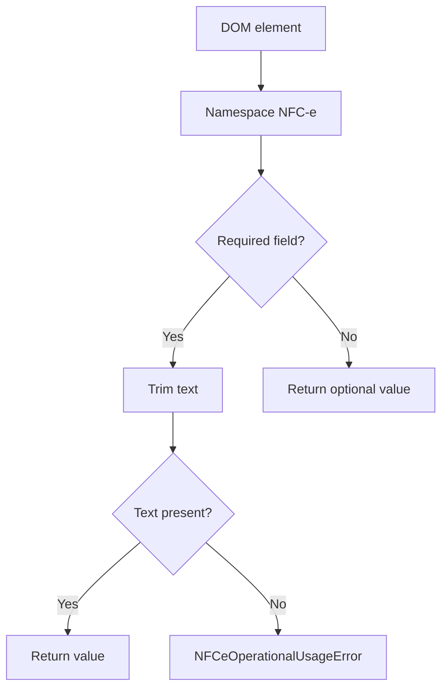

# Utilitarios XML DANFE NFC-e SP

## Visao geral

O modulo fornece operacoes locais de leitura de elementos e texto em documentos XML fiscais NFC-e.

## Responsabilidades

- Restringir consultas diretas aos elementos do namespace fiscal NFC-e.
- Localizar filhos diretos e descendentes pelo nome local do elemento.
- Normalizar valores de texto e rejeitar campos obrigatorios ausentes.

## Entradas e saidas

- Entradas: elementos DOM fornecidos por `@xmldom/xmldom`.
- Saidas: elementos filhos, listas de descendentes, texto opcional ou texto obrigatorio.
- O modulo exporta um unico objeto default com as funcoes de consulta.

## API / Assinatura

```ts
const xml = {
  child,
  descendants,
  localName,
  requiredText,
  text,
};
export default xml;
```

## Fluxo principal



## Tratamento de erros e casos-limite

- Apenas filhos no namespace NFC-e sao considerados filhos fiscais.
- Texto ausente ou composto apenas por espacos e considerado vazio.
- `requiredText` lanca `NFCeOperationalUsageError` quando o elemento ou seu valor nao existe.

## Exemplos

```ts
const issuerName = xml.requiredText(issuer, 'xNome', 'emit/xNome');
```

## Dependencias e integracoes

- Tipos DOM de `@xmldom/xmldom`.
- Utilizado pela [correlacao de evidencia](./render-nfce-sp-danfe.doc.md) e pela [projecao fiscal](./render-nfce-sp-danfe-projection.doc.md).
