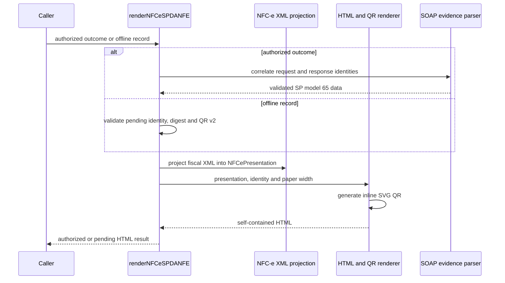

# Renderer DANFE NFC-e SP

## Visao geral

`renderNFCeSPDANFE` produz HTML autocontido para uma NFC-e de SP autorizada ou para um registro offline explicitamente pendente. O modulo nao transmite XML nem consulta a SEFAZ.

## Responsabilidades

- Validar a correlacao da evidencia SOAP para a entrada autorizada ou a identidade, digest e QR offline do registro pendente.
- Extrair o XML fiscal correspondente sem transformar um registro pendente em documento autorizado.
- Delegar a projecao de campos fiscais ao modulo de apresentacao tipado.
- Delegar o HTML e o QR SVG inline ao renderizador de apresentacao.
- Calcular o digest SHA-256 do envelope de requisicao preservado no resultado.

## Entradas e saidas

- Entrada: `RenderNFCeSPDANFERequest` com evidência autorizada ou registro offline pendente e largura opcional entre 56 e 210 mm.
- Saida: `NFCeSPDanfeResult` para autorização ou `NFCeSPOfflineDanfeResult` para contingência pendente.
- Homologacao imprime o aviso `EMITIDA EM AMBIENTE DE HOMOLOGAÇÃO – SEM VALOR FISCAL`.

## API / Assinatura

```ts
export function renderNFCeSPDANFE(
  input: RenderNFCeSPDANFERequest,
): Promise<NFCeSPDanfeResult | NFCeSPOfflineDanfeResult>;
```

## Fluxo principal



## Tratamento de erros e casos-limite

- Para entrada autorizada, resultado diferente de `authorized`, transporte nao sucedido, resposta contraditoria ou protocolo incorreto causa `NFCeOperationalUsageError`.
- Para entrada offline, registro nao pendente, XML ausente/malformado, digest divergente ou QR v2 incorreto causa `NFCeOperationalUsageError`; o HTML identifica pendencia e omite protocolo.
- Chave deve ser SP modelo 65, com 44 digitos e digito verificador valido.
- Largura deve ser finita e inclusiva no intervalo de 56 a 210 mm; o padrao e 80 mm.
- Todo item exige codigo, descricao, quantidade, unidade, preco unitario e total; nao ha truncamento de item.
- Texto XML e escapado; HTML nao inclui scripts, imagens externas ou estilos remotos.

## Exemplos

```ts
const danfe = await renderNFCeSPDANFE({
  authorization,
  paperWidthMm: 80,
});

await writeFile('nfce.html', danfe.html, 'utf8');
```

`authorization` deve ser o resultado preservado de `authorizeNFCe` para o mesmo documento, sem alteracao de chave, ambiente, protocolo ou URL.

## Dependencias e integracoes

- `@xmldom/xmldom` para leitura de envelopes SOAP e XML fiscal.
- [Projecao fiscal](./render-nfce-sp-danfe-projection.doc.md) e [utilitarios XML](./render-nfce-sp-danfe-xml.doc.md) para extracao de campos.
- [Modelo interno](./render-nfce-sp-danfe-model.doc.md) para os campos fiscais projetados.
- [Renderizador HTML](./render-nfce-sp-danfe-html.doc.md) para markup seguro, CSS de impressao e QR local.
- `node:crypto` para o digest do envelope.
- `NFCeAuthorizationOutcome` e `NFCeOperationalUsageError`.
- `NFCeSPOfflineRecord` para a renderizacao pendente sem evidência de autorizacao.
- [Contrato publico](../../../specs/028-nfce-sp-danfe/contracts/public-nfce-sp-danfe-rendering.md).
