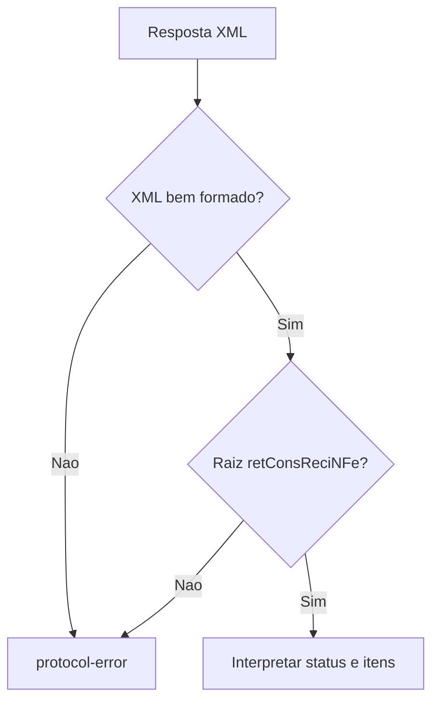

# async-batch-retrieval.ts

## Visao geral

Interpreta a resposta XML de consulta de recibo da autorizacao assincrona de NF-e.

## Responsabilidades

- Validar a formacao do XML recebido antes de interpretar seu status.
- Aceitar somente a raiz `retConsReciNFe` para uma resposta de consulta de recibo.
- Produzir um resultado de protocolo invalido quando o XML estiver malformado ou tiver outra raiz.

## Entradas e saidas

- Entrada: XML de resposta da SEFAZ como `string`.
- Saida: `NFeAsyncBatchOutcome`, incluindo a classificacao e os itens de autorizacao identificados.

## API / Assinatura

```ts
export function parseRetConsReciNFe(xml: string): NFeAsyncBatchOutcome;
```

## Fluxo principal



## Tratamento de erros e casos-limite

- Erros e falhas fatais reportados pelo parser impedem a classificacao do conteudo e resultam em `protocol-error`.
- XML bem formado com elemento raiz diferente de `retConsReciNFe` resulta em `protocol-error`.
- A resposta original e preservada no resultado para diagnostico.

## Exemplos

```ts
const outcome = parseRetConsReciNFe(
  '<retConsReciNFe><tpAmb>1</tpAmb><cStat>105</cStat></retConsReciNFe>',
);
```

## Dependencias e integracoes

- `@xmldom/xmldom` para validar e analisar a estrutura XML.
- `./contracts.js` para o contrato `NFeAsyncBatchOutcome`.
- `reconcileNFeReceipt` consome o resultado para concluir a reconciliacao de um recibo conhecido.
