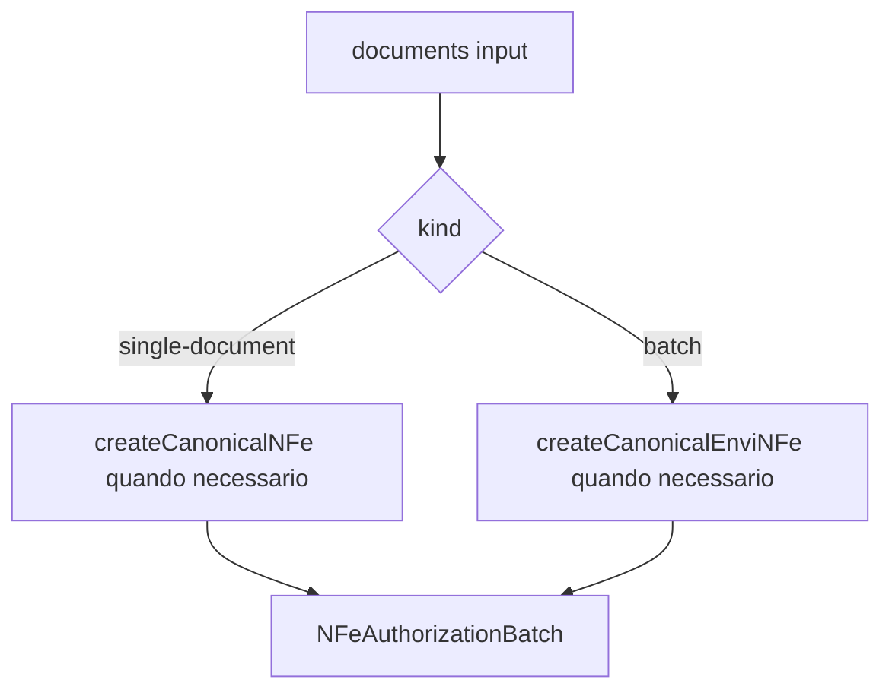

# src/canonical/nfe/authorization-batch.ts

## Visao geral

Normaliza a entrada de autorizacao operacional para um lote canonico unico, independentemente de a chamada ser de documento unico ou lote.

## Responsabilidades

- Aceitar documento canonico unico ou lote canonico.
- Reusar a camada canonica existente quando a entrada ainda estiver crua.
- Produzir um shape uniforme para a orquestracao operacional.

## Entradas e saidas

- Entradas: `NFeAuthorizationDocumentsInput`.
- Saidas: `NFeAuthorizationBatch`.

## Fluxo principal



## Tratamento de erros e casos-limite

- O helper delega as validacoes canonicas para `createCanonicalNFe` e `createCanonicalEnviNFe`.
- Documento unico recebe um `batchId` sintetico estavel para evitar bifurcacao na orquestracao.

## Exemplos

```ts
import { buildNFeAuthorizationBatch } from './authorization-batch.js';
```

## Dependencias e integracoes

- `./canonical-envi-nfe.js`
- `./canonical-nfe.js`
- `./contracts.js`