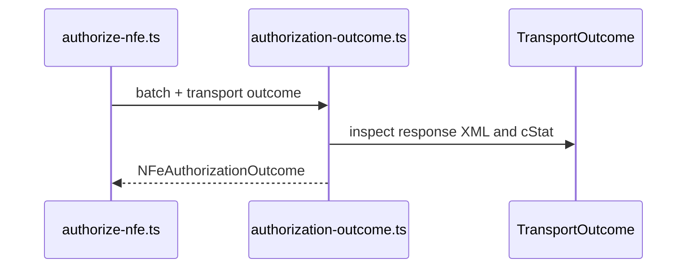

# src/canonical/nfe/authorization-outcome.ts

## Visao geral

Traduz a resposta do transporte de autorizacao para um resultado operacional voltado ao integrador.

## Responsabilidades

- Reaproveitar a classificacao do transporte.
- Extrair protocolo e recibo do XML observado.
- Confirmar `tpAmb` e os identificadores exigidos antes de mapear sucesso em producao.
- Produzir um resultado uniforme para documento unico ou lote.
- Indicar `reconcileNFeReceipt` como proxima acao quando houver recebimento confirmado e `nRec`.
- Manter a classificacao fiscal separada dos metadados de contingency/recovery adicionados pela orquestracao.

## Entradas e saidas

- Entradas: `NFeAuthorizationBatch` e `TransportOutcome`.
- Saidas: `NFeAuthorizationOutcome`.

## Fluxo principal



## Tratamento de erros e casos-limite

- `cStat` `100` e `104` com protocolo sao tratados como autorizacao concluida.
- `cStat` `103` com recibo e tratado como estado intermediario recebido.
- Em producao, `tpAmb` diferente de `1`, `nProt` ausente em `100`/`104` ou `nRec` ausente em `103` resulta em `protocol-error`.
- Para a classificacao `received` com `receiptNumber`, `nextAction` identifica a facade de continuacao; nao inicia consulta automaticamente.
- Outros cenarios reaproveitam a classificacao herdada do transporte.
- A orquestracao pode acrescentar `executionMode`, `contingencyState`, chave, protocolo EPEC, `recoveryContext` e `recoveryState` sem reclassificar o resultado do transporte.

## Exemplos

```ts
import { mapAuthorizationTransportOutcome } from './authorization-outcome.js';

const continuation = {
  classification: 'received',
  receiptNumber: '135260000000002',
  nextAction: 'reconcileNFeReceipt',
};
```

## Dependencias e integracoes

- `../transport/contracts.js`
- `./contracts.js`
- `./transport-outcome-mapper.js`