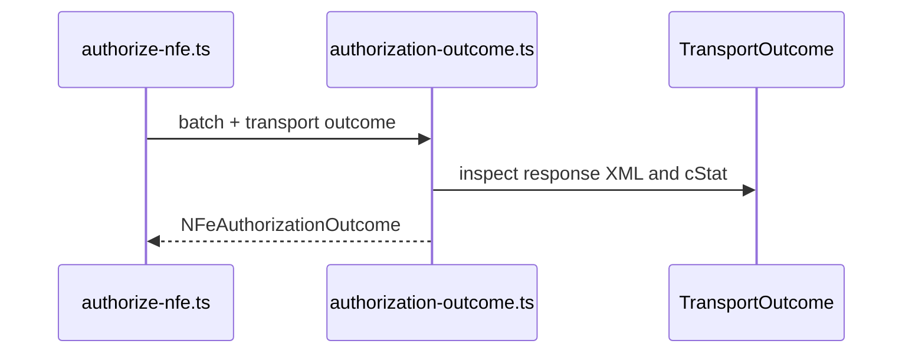

# src/canonical/nfe/authorization-outcome.ts

## Visao geral

Traduz a resposta do transporte de autorizacao para um resultado operacional voltado ao integrador.

## Responsabilidades

- Reaproveitar a classificacao do transporte.
- Extrair protocolo e recibo do XML observado.
- Produzir um resultado uniforme para documento unico ou lote.

## Entradas e saidas

- Entradas: `NFeAuthorizationBatch` e `TransportOutcome`.
- Saidas: `NFeAuthorizationOutcome`.

## Fluxo principal



## Tratamento de erros e casos-limite

- `cStat` `100` e `104` com protocolo sao tratados como autorizacao concluida.
- `cStat` `103` com recibo e tratado como estado intermediario recebido.
- Outros cenarios reaproveitam a classificacao herdada do transporte.

## Exemplos

```ts
import { mapAuthorizationTransportOutcome } from './authorization-outcome.js';
```

## Dependencias e integracoes

- `../transport/contracts.js`
- `./contracts.js`
- `./transport-outcome-mapper.js`