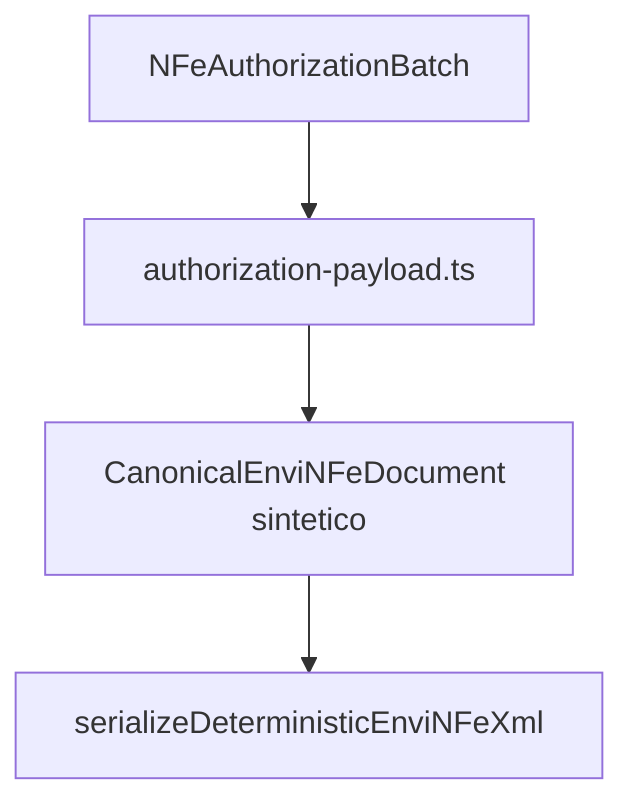

# src/canonical/nfe/authorization-payload.ts

## Visao geral

Converte um lote operacional normalizado no XML deterministico usado pela autorizacao de NFe.

## Responsabilidades

- Receber o lote operacional ja normalizado.
- Garantir que o envio sempre siga o envelope `enviNFe`.
- Reaproveitar a serializacao deterministica existente.

## Entradas e saidas

- Entradas: `NFeAuthorizationBatch`.
- Saidas: XML `enviNFe` pronto para a camada de transporte.

## Fluxo principal



## Tratamento de erros e casos-limite

- Lotes vazios falham com `NFeOperationalUsageError`.
- O helper nao resolve endpoint nem executa transporte.

## Exemplos

```ts
import { createAuthorizationPayloadXml } from './authorization-payload.js';
```

## Dependencias e integracoes

- `../serialization/deterministic-xml.js`
- `./contracts.js`
- `./errors.js`