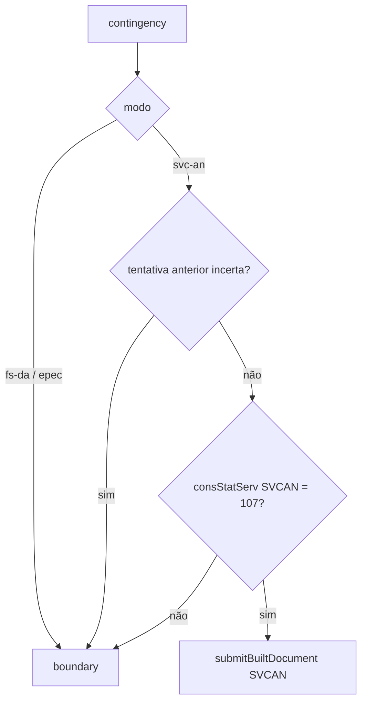

# authorize-built-document-svc-an

## Visão geral

Contingência SVC-AN para documento montado com `buildNFeDocument` (`tpEmis` 6).

## Responsabilidades

Verifica o status do SVC-AN, aplica as recusas de contingência e envia o documento ao autorizador SVCAN.

## Entradas e saídas

Entrada: requisição com `contingency`, documento e ambiente. Saída: autorização com `executionMode: 'svc-an'` ou `contingency-boundary`.

## Fluxo principal



## Tratamento de erros e casos-limite

Sem `requestExecutor`, status diferente de 107 ou falha ao consultar o status: nada é enviado (`unavailable`/`inconclusive`). `documentKey` divergente da chave do documento é recusado.

## Exemplos

```ts
await authorizeNFe({ contingency: { mode: 'svc-an' }, documents: { kind: 'built-document', payload: built }, environment: 'production', requestExecutor, signingContext });
```

## Dependências e integrações

[submit-built-document.ts](./submit-built-document.ts), [contingency-boundary-outcome.ts](./contingency-boundary-outcome.ts), `queryNFeServiceStatus`.
