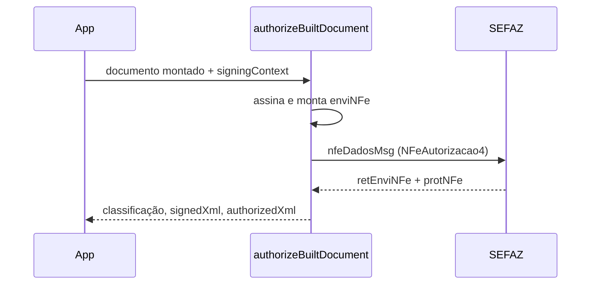

# authorizeBuiltDocument

## Visão geral

Caminho de `authorizeNFe` para `documents.kind = 'built-document'`: assina o documento montado por `buildNFeDocument`, envia um `enviNFe` real (síncrono, `indSinc` 1) no envelope SOAP 1.2 da SEFAZ (`nfeDadosMsg` com o namespace do WSDL) e classifica a resposta.

## Responsabilidades

- Conferir `tpAmb` do documento com o ambiente solicitado; produção só para emitente de SP e com `requestExecutor` (TLS mútuo).
- Exigir coerência do tipo de emissão: sem `contingency`, o documento deve ter `tpEmis` 1 (e posição 35 da chave 1); com `contingency.mode = 'svc-an'`, `tpEmis` 6 (montado com `dhCont` e `xJust`). A chave de acesso muda com o modo, por isso o documento precisa ser montado já no modo escolhido.
- SVC-AN (homologação e produção): delega a [authorize-built-document-svc-an.ts](./authorize-built-document-svc-an.ts), que consulta o status do SVC-AN (`consStatServ`, `cStat` 107 recente), recusa `fs-da`/`epec` e reenvio de chave incerta, e envia uma única vez ao autorizador `SVCAN` (`hom.sefazvirtual…`/`www.sefazvirtual…`). Resultado com `executionMode: 'svc-an'`, `contingencyState: 'activation-verified'` e `activationEvidence`; status diferente de 107 devolve `contingency-boundary` sem enviar nada. O envio (assinatura + `enviNFe` + classificação) vive em `submit-built-document.ts`.
- Devolver `signedXml` e, quando autorizado, o `authorizedXml` (`nfeProc` = NFe assinada + `protNFe`).
- Classificar pelo protocolo: `100`/`150` autorizado; `110`/`301`/`302` denegado; qualquer outro `cStat` do protocolo, rejeitado (mesmo com o lote em `104`); `103` com recibo, recebido.

## Entradas e saídas

Entrada: `{ kind: 'built-document', payload: BuiltNFeDocument, batchId? }`. Saída: `NFeAuthorizationOutcome` com `protocolStatusCode`, `protocolStatusMessage`, `signedXml` e `authorizedXml`.

## Fluxo principal



## Tratamento de erros e casos-limite

Produção fora de SP recusada; produção sem executor recusada; `tpAmb` divergente recusado. Para emitente de SP em homologação o catálogo ainda não tem os endpoints próprios de SP (usa o autorizador padrão do ambiente) — pendência T150.

## Exemplos

```ts
const outcome = await authorizeNFe({
  documents: { kind: 'built-document', payload: built },
  environment: 'homologation',
  signingContext,
  requestExecutor,
});
```

## Dependências e integrações

`submitBuiltDocument` (`signNFeXml`, `executeNFeSoapService` com `wireFormat`, `mapAuthorizationTransportOutcome`, `assembleNfeProc`), `queryNFeServiceStatus` (modo SVC-AN) e `createContingencyBoundaryOutcome`.
