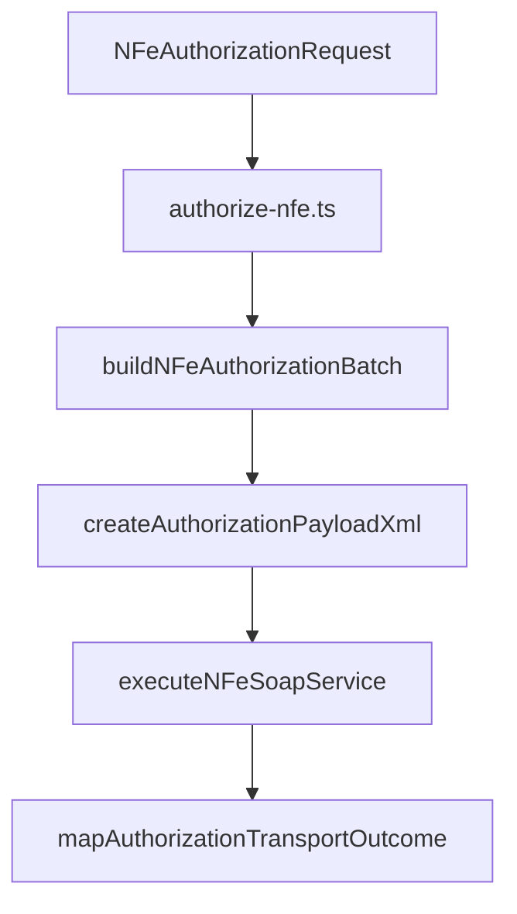

# src/canonical/nfe/authorize-nfe.ts

## Visao geral

Orquestra a autorizacao operacional de NFe sobre as camadas canonica e de transporte.

## Responsabilidades

- Validar o recorte de ambiente suportado pelo MVP.
- Normalizar o envio como lote operacional.
- Gerar o payload XML e acionar a autorizacao SOAP.
- Traduzir o resultado do transporte para um outcome operacional.

## Entradas e saidas

- Entradas: `NFeAuthorizationRequest`.
- Saidas: `Promise<NFeAuthorizationOutcome>`.

## Fluxo principal



## Tratamento de erros e casos-limite

- Sem `signingContext`, a operacao falha com `NFeOperationalUsageError`.
- Ambientes fora de homologacao falham com `NFeOperationalUnsupportedScopeError`.
- Falhas de transporte seguem no resultado estruturado quando a camada SOAP consegue classifica-las.

## Exemplos

```ts
import { authorizeNFe } from './authorize-nfe.js';
```

## Dependencias e integracoes

- `../transport/execute-nfe-soap-service.js`
- `./authorization-batch.js`
- `./authorization-outcome.js`
- `./authorization-payload.js`
- `./errors.js`