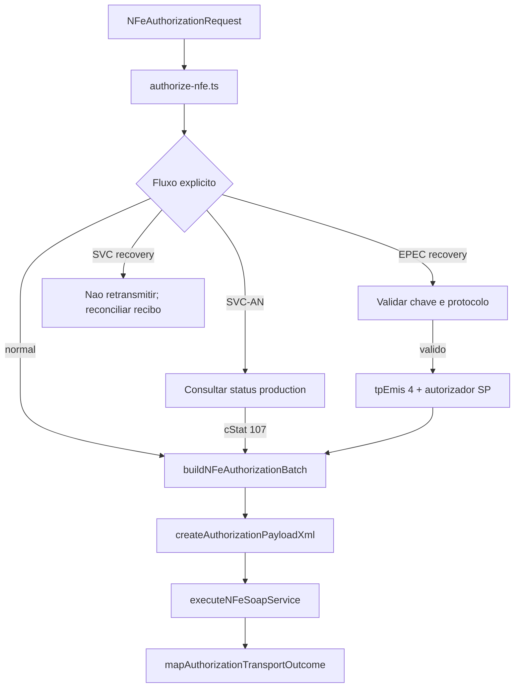

# src/canonical/nfe/authorize-nfe.ts

## Visao geral

Orquestra a autorizacao operacional de NFe sobre as camadas canonica e de transporte.

## Responsabilidades

- Validar ambiente e identidade emissora antes da autorizacao.
- Exigir executor injetado para producao SP.
- Normalizar o envio como lote operacional.
- Gerar o payload XML e acionar a autorizacao SOAP.
- Traduzir o resultado do transporte para um outcome operacional.
- Processar recovery EPEC apenas por chamada explicita, validando a chave e o protocolo do evento.

## Entradas e saidas

- Entradas: `NFeAuthorizationRequest`, com `contingency` ou `recoveryContext` opcionais.
- Saidas: `Promise<NFeAuthorizationOutcome>` com classificacao preservada e metadados de contingencia/recovery.

## Fluxo principal



## Tratamento de erros e casos-limite

- Sem `signingContext`, a operacao falha com `NFeOperationalUsageError`.
- Em producao, todos os documentos precisam resolver consistentemente para SP por `cUF` e/ou chave de acesso de 44 digitos.
- SVC-AN exige solicitacao explicita e uma consulta de status de producao com `cStat=107`; a autorizacao usa `tpEmis=6`.
- Recovery EPEC exige documento unico, chave identica, protocolo de evento numerico com 15 digitos, UF SP e ambiente de producao; o XML usa `tpEmis=4` e autorizador SP.
- Recovery SVC-AN nunca retransmite o documento; indica a conciliacao do recibo conhecido. FS-DA permanece assistido e nao automatizado.
- A classificacao original continua separada do `recoveryState`; nenhum fluxo inicia polling ou retry.
- Producao exige `requestExecutor` configurado pelo integrador para mTLS; outras UFs suportadas pela contingencia continuam retornando boundary explicita.
- Homologacao preserva o executor default e o comportamento anterior.
- Falhas de transporte seguem no resultado estruturado quando a camada SOAP consegue classifica-las.

## Exemplos

```ts
import { authorizeNFe } from './authorize-nfe.js';
```

## Dependencias e integracoes

- `../transport/execute-nfe-soap-service.js`
- `./authorization-batch.js`
- `./authorization-outcome.js`
- `./authorization-payload.js`
- `./errors.js`