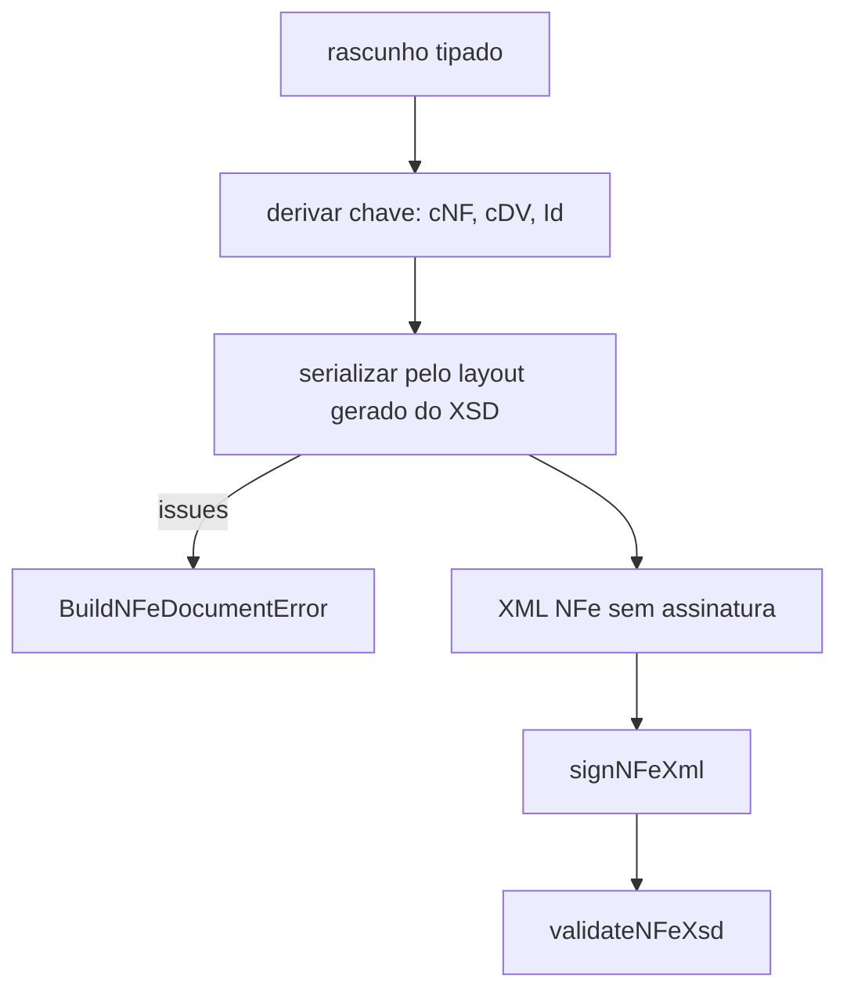

# buildNFeDocument

## Visão geral

Monta o XML não assinado da NF-e (layout 4.00, `PL_010c_NT2022_002v1.30`) a partir de um rascunho tipado (`NFeDocumentInput`). Os nomes seguem o XSD oficial; decimais e datas são texto e nunca são convertidos.

## Responsabilidades

- Derivar `cNF` (8 dígitos, diferente de `nNF` e fora da lista oficial de valores inválidos), `cDV`, a chave de acesso (44 dígitos), `Id` (`NFe` + chave), `versao` e `@nItem`.
- Emitir cada elemento na ordem do XSD, independentemente da ordem das chaves no rascunho.
- Recusar, antes de assinar, entrada incompleta, campo não suportado, alternativas conflitantes, valores vazios ou com espaços nas pontas, números não inteiros e mais de 990 itens.

## Entradas e saídas

```ts
interface NFeDocumentInput { cNF?: string; infNFe: NFeInfNFeInput }
interface BuiltNFeDocument { accessKey: string; cDV: string; cNF: string; id: string; xml: string }
class BuildNFeDocumentError extends Error { issues: readonly string[] }
```

## Fluxo principal



## Tratamento de erros e casos-limite

- Emitente CPF: a chave usa o CPF com zeros à esquerda até 14 dígitos.
- `cDV` informado diferente do calculado é recusado.
- `ide.cNF` e o `cNF` da raiz são aceitos; sem nenhum, é gerado aleatoriamente.
- A validação contra o XSD exige o documento assinado (a assinatura é obrigatória no esquema) e `xmllint` instalado.

## Exemplos

```ts
const { xml, accessKey } = buildNFeDocument(draft);
const signed = await signNFeXml({ signingContext, unsignedXml: xml });
```

## Dependências e integrações

`computeNFeAccessKey`, o layout gerado em [nfe-layout.generated.ts](nfe-layout.generated.ts) e o serializador [nfe-layout-serializer.doc.md](nfe-layout-serializer.doc.md). Usado por `authorizeNFe` com `documents.kind = 'built-document'`.
