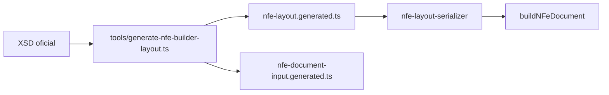

# builder

## Visão geral

Construtor do documento NF-e 4.00. Os arquivos `nfe-layout.generated.ts` e `nfe-document-input.generated.ts` são gerados do XSD oficial por `tools/generate-nfe-builder-layout.ts` e não devem ser editados.

## Responsabilidades

Manter o layout (ordem, ocorrências, atributos) e os tipos de entrada sincronizados com o esquema, sem tabelas escritas à mão.

## Entradas e saídas

Entrada do gerador: `xsd/PL_010c_NT2022_002v1.30/leiauteNFe_v4.00.xsd` (e tipos básicos incluídos). Saídas: layout e tipos TypeScript.

## Fluxo principal

## Tratamento de erros e casos-limite

O gerador falha ao encontrar partículas XSD não suportadas (apenas `sequence`, `choice` e `element` são tratadas; `ds:Signature` fica a cargo do assinador).

## Exemplos

`npx tsx tools/generate-nfe-builder-layout.ts` → "Generated N types."

## Dependências e integrações

`@xmldom/xmldom` para ler o XSD; ver [build-nfe-document.doc.md](build-nfe-document.doc.md).
