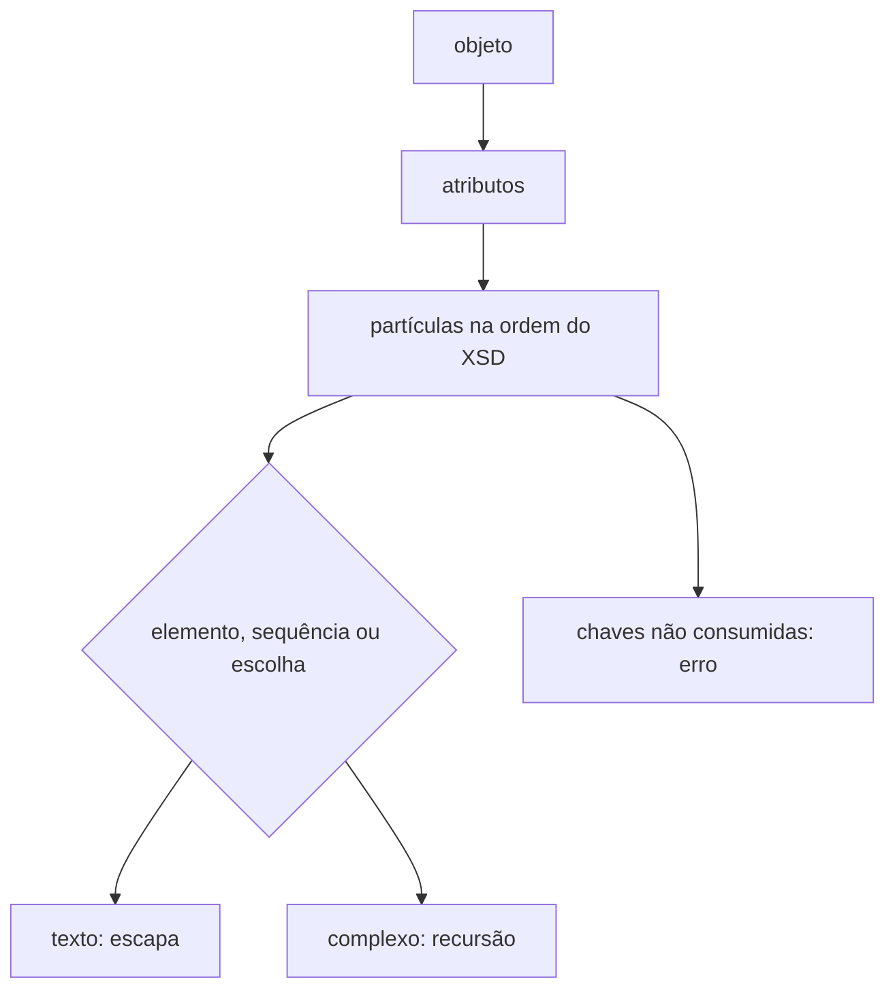

# nfe-layout-serializer

## Visão geral

Serializador genérico guiado pelo layout NF-e 4.00 gerado a partir do XSD (`tools/generate-nfe-builder-layout.ts`). Percorre partículas (`element`, `sequence`, `choice`) na ordem do esquema.

## Responsabilidades

Emitir elementos em ordem, validar obrigatoriedade e ocorrências, resolver alternativas (`choice`) — inclusive as que compartilham membros opcionais, como `IPI` em `imposto` —, escapar texto XML e acumular todos os problemas com o caminho do campo.

## Entradas e saídas

`serializeComplex(name, typeId, value, path, issues)` devolve o XML do elemento e preenche `issues`. Atributos usam o prefixo `@` (por exemplo `@nItem`).

## Fluxo principal

## Tratamento de erros e casos-limite

Campo desconhecido, lista em lugar de valor único (e o inverso), mínimo/máximo de ocorrências, texto vazio ou com espaços nas pontas e números não inteiros geram um item em `issues`.

## Exemplos

Ver `tests/integration/build-nfe-document.test.ts`.

## Dependências e integrações

`nfe-layout.generated.ts` (gerado; não editar). Regenerar com `npx tsx tools/generate-nfe-builder-layout.ts` quando o XSD mudar.
