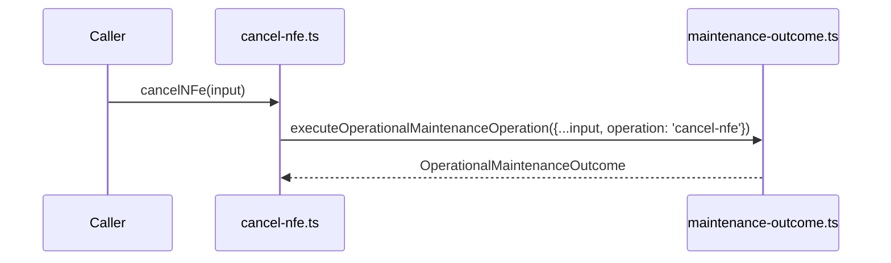

# src/canonical/nfe/cancel-nfe.ts

## Visao geral

Expõe a operacao interna de cancelamento homologado usando a orquestracao compartilhada de manutencao.

## Responsabilidades

- Fixar o identificador operacional `cancel-nfe`.
- Delegar a execucao para `executeOperationalMaintenanceOperation`.
- Preservar a assinatura enxuta da operacao especifica.

## Entradas e saidas

- Entradas: `OperationalMaintenanceFacadeInput`.
- Saidas: `Promise<OperationalMaintenanceOutcome>`.

## Fluxo principal



## Tratamento de erros e casos-limite

- A validacao de ambiente e o mapeamento do transporte ficam centralizados no modulo compartilhado.

## Exemplos

```ts
import { cancelNFe } from './cancel-nfe.js';
```

## Dependencias e integracoes

- `./maintenance-outcome.js`
- `./contracts.js`
