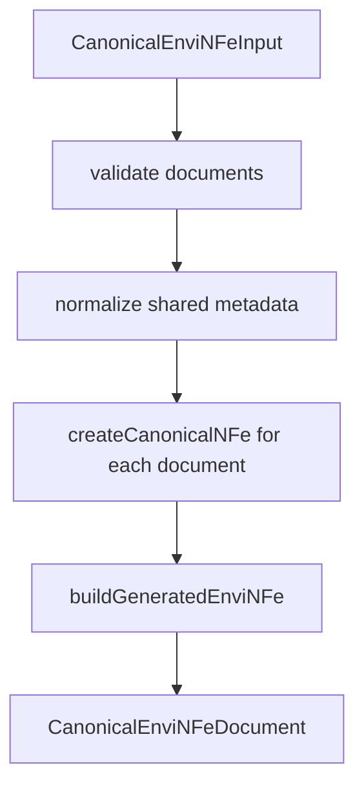

# src/canonical/nfe/canonical-envi-nfe.ts

## Visao geral

Materializa o lote canonico `enviNFe` retornado pela facade publica.

## Responsabilidades

- Validar que o lote tem ao menos um documento.
- Normalizar metadados compartilhados do lote.
- Reutilizar a criacao canonica de `NFe` antes da montagem do batch.
- Anexar as lacunas adiadas que ainda delimitam a slice inicial.

## Entradas e saidas

- Entradas: `CanonicalEnviNFeInput`.
- Saidas: `CanonicalEnviNFeDocument`.

## API / Assinatura

```ts
export function createCanonicalEnviNFe(
  input: CanonicalEnviNFeInput,
): CanonicalEnviNFeDocument;
```

## Fluxo principal



## Tratamento de erros e casos-limite

- Lanca erro quando o lote nao possui documentos.
- Reaproveita as validacoes de `NFe` para cada documento do batch.

## Exemplos

```ts
const batch = createCanonicalEnviNFe({
  batchId: '1',
  documents: [{ documentId: 'NFe001', environment: 'homologation', version: '4.00' }],
  environment: 'homologation',
  version: '4.00',
});
```

## Dependencias e integracoes

- `./canonical-nfe`
- `./generated-nfe-adapter`
- `../shared/contracts`