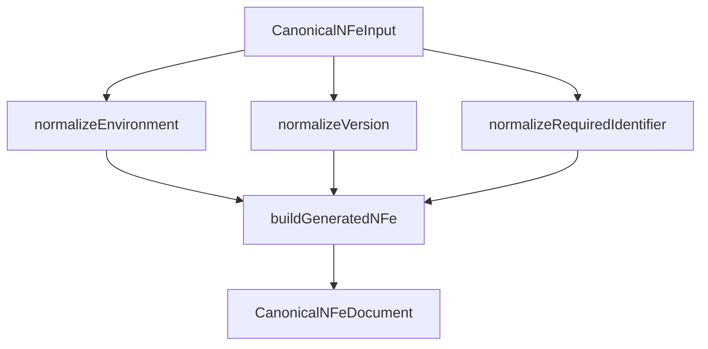

# src/canonical/nfe/canonical-nfe.ts

## Visao geral

Materializa o documento canonico `NFe` retornado pela facade publica.

## Responsabilidades

- Normalizar a entrada de `NFe`.
- Gerar metadados canonicos com proveniencia rastreavel.
- Produzir uma estrutura publica sem expor a classe gerada diretamente.
- Anexar as lacunas adiadas que ainda delimitam a slice inicial.

## Entradas e saidas

- Entradas: `CanonicalNFeInput`.
- Saidas: `CanonicalNFeDocument`.

## API / Assinatura

```ts
export function createCanonicalNFe(input: CanonicalNFeInput): CanonicalNFeDocument;
```

## Fluxo principal



## Tratamento de erros e casos-limite

- Falha quando `environment`, `version` ou `documentId` sao invalidos.
- Mantem `payload` vazio quando nenhum fragmento adicional e fornecido.

## Exemplos

```ts
const document = createCanonicalNFe({
  documentId: 'NFe001',
  environment: 'homologation',
  version: '4.00',
});
```

## Dependencias e integracoes

- `./generated-nfe-adapter`
- `../shared/contracts`