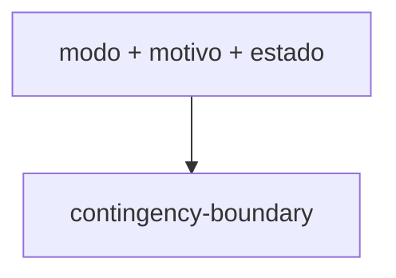

# contingency-boundary-outcome

## Visão geral

Monta o resultado `contingency-boundary` de um pedido de contingência diagnosticado sem transporte.

## Responsabilidades

Preenche estado de contingência, modo, motivo, chave e uma evidência de transporte vazia.

## Entradas e saídas

Entrada: modo, motivo, estado e chave opcional. Saída: `NFeAuthorizationOutcome`.

## Fluxo principal



## Tratamento de erros e casos-limite

Provedor é `SVCAN` para `svc-an`/`epec` e `SP` para os demais.

## Exemplos

```ts
createContingencyBoundaryOutcome('fs-da', 'procedimento assistido', 'operator-assisted', key);
```

## Dependências e integrações

Usado por [authorize-nfe.ts](./authorize-nfe.ts) e [authorize-built-document-svc-an.ts](./authorize-built-document-svc-an.ts).
