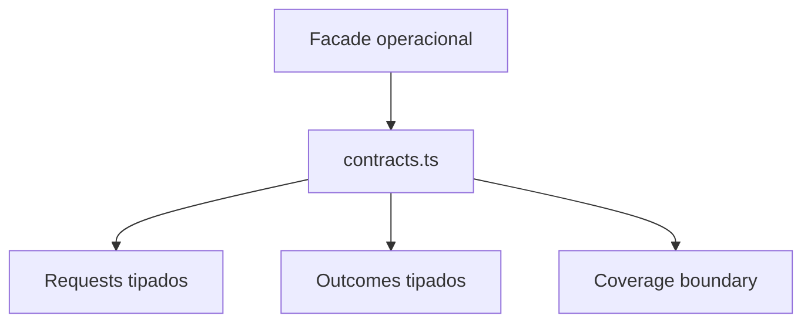

# src/canonical/nfe/contracts.ts

## Visao geral

Centraliza os contratos tipados que descrevem entradas, resultados e limites do MVP operacional de NFe.

## Responsabilidades

- Definir o formato da autorizacao operacional.
- Tipar `nextAction` como a facade de reconciliacao do recibo quando uma autorizacao retorna um recibo conhecido.
- Definir os resultados de consulta e manutencao.
- Publicar as classificacoes operacionais aceitas pelo slice.

## Entradas e saidas

- Entradas: payloads canonicos, contexto de assinatura, timeout e executor opcional.
- Saidas: tipos estruturados para resultados e limites de cobertura.

## Fluxo principal



## Tratamento de erros e casos-limite

- O arquivo nao executa validacao de runtime.
- As classificacoes ficam centralizadas para evitar duplicacao entre autorizacao, consulta e manutencao.
- `NFeAuthorizationRequest` aceita producao apenas para documentos identificados como SP e requer executor externo para mTLS.
- `NFeAuthorizationOutcome.nextAction` e opcional e usa o literal `reconcileNFeReceipt`; resultados sem recibo nao anunciam essa continuacao.

## Exemplos

```ts
import type { NFeAuthorizationRequest } from './contracts.js';
```

## Dependencias e integracoes

- `../shared/contracts.js`
- `../signing/contracts.js`
- `../transport/contracts.js`
- `../transport/request-executor.js`