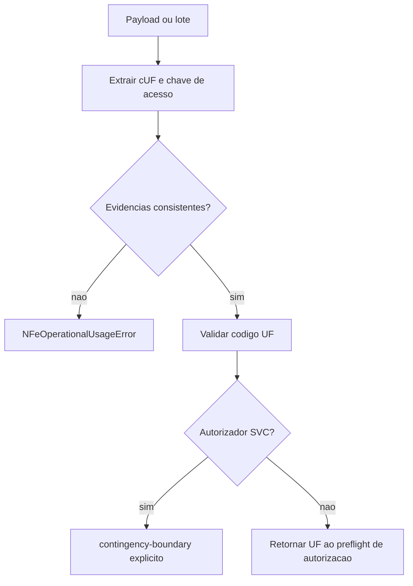

# coverage-boundary.ts

## Visao geral

Resolve a identidade fiscal da NF-e antes de decidir se a autorizacao em producao pertence ao autorizador normal de SP ou a um boundary de contingencia ja suportado.

## Responsabilidades

- Extrair `cUF` do payload e UF de uma chave de acesso de 44 digitos.
- Rejeitar evidencia ausente, malformada, contraditoria ou divergente entre documentos do lote.
- Validar que a UF e conhecida pelo roteamento operacional.
- Produzir o resultado explicito de contingencia para UFs encaminhadas a `SVC-AN` ou `SVC-RS`.

## Entradas e saidas

- Entradas: payload unitario ou lote, aceito como dado externo ainda nao validado.
- Saidas: codigo de UF consistente ou `NFeAuthorizationOutcome` de boundary de contingencia.
- Erros: `NFeOperationalUsageError` para identidade incompleta, invalida, conflitante, mista ou desconhecida.

## Fluxo principal



## Tratamento de erros e casos-limite

- Todos os documentos de um lote precisam resolver para a mesma UF.
- Quando `cUF` e chave estao presentes, os dois valores devem concordar.
- A chave de acesso so participa quando tem exatamente 44 digitos e formato valido; formatos malformed sao rejeitados pelo preflight.
- O modulo nao executa rede nem seleciona fallback automatico.

## Exemplos

```ts
const issuerUF = resolveNFeIssuerUF({
  documentId: '35240100000000000000550010000000011000000010',
  payload: { cUF: '35' },
});
```

## Dependencias e integracoes

- `./contracts.js`
- `./errors.js`
- `../transport/uf-routing.js`
- Chamado pelo preflight de `authorize-nfe.ts`.
