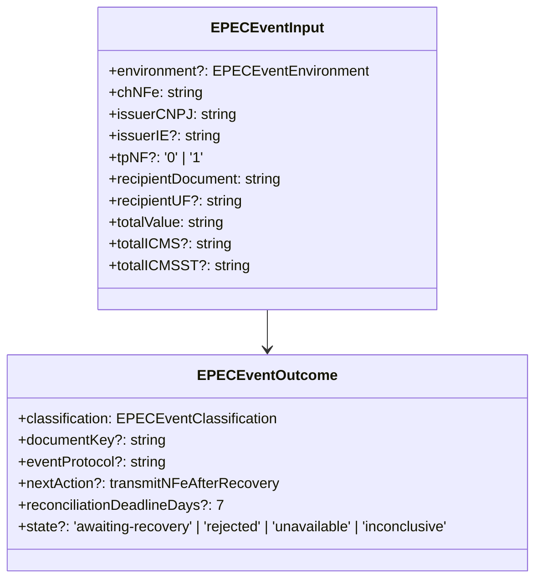

# EPEC Contracts

## Visao geral

Define os dados de entrada e o resultado tipado para construir e submeter um evento EPEC.

## Responsabilidades

- Exigir os dados fiscais usados pelo leiaute do evento.
- Preservar homologacao como ambiente default para compatibilidade.
- Representar o protocolo aceito, a acao de recovery e o prazo paulista de reconciliacao.

## Entradas e saidas

- Entrada: `EPECEventInput`, com chave NF-e, emitente, destinatario, totais, emissao, ambiente e executor.
- Saida: `EPECEventOutcome`, com classificacao, protocolo, estado, destino SVC e orientacao de recovery.

## Fluxo principal



## Tratamento de erros e casos-limite

- Production exige os detalhes fiscais completos e um executor mTLS.
- Um protocolo de evento invalido nao pode produzir `registered`.
- O prazo de sete dias e orientacao; o contrato nao representa timers ou armazenamento.

## Exemplos

```ts
const result = await submitEPECEvent({
  environment: 'production',
  chNFe,
  issuerCNPJ,
  issuerIE,
  issuerUF: '35',
  recipientDocument,
  recipientUF: 'RJ',
  totalValue: '100.00',
  totalICMS: '18.00',
  totalICMSST: '0.00',
  tpNF: '1',
  emissionDateTime,
  signingContext,
  requestExecutor,
});
```

## Dependencias e integracoes

- `./epec-builder.ts`
- `../transport/request-executor.ts`
- XSD `xsd/Evento_EPEC_PL_v1.01/e110140_v1.00.xsd`