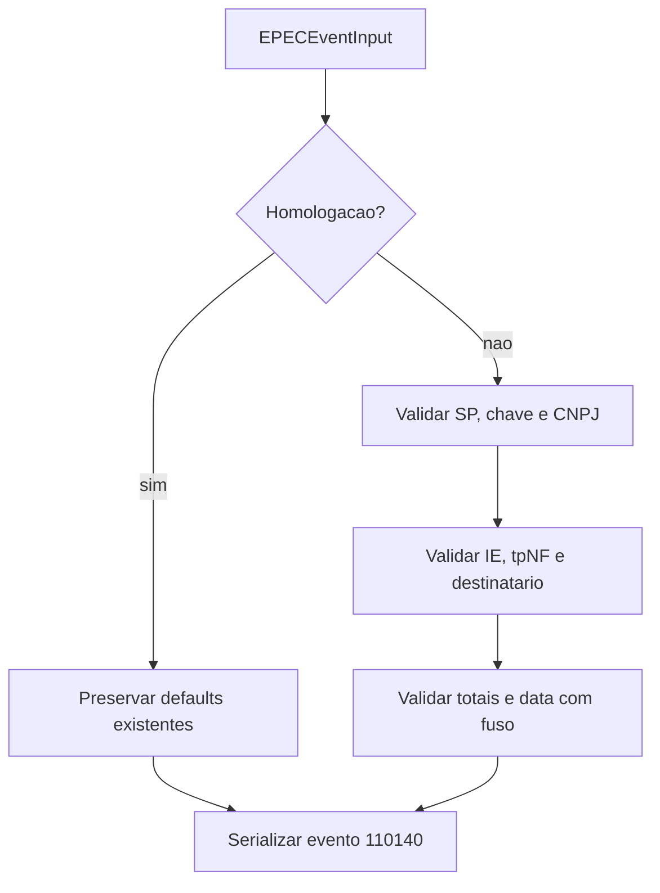

# EPEC Builder

## Visao geral

Valida os detalhes fiscais de producao e serializa o evento EPEC `110140` conforme o XSD existente.

## Responsabilidades

- Construir `detEvento` e o envelope de evento.
- Declarar o namespace oficial NF-e e serializar `nSeqEvento` no formato aceito pelo XSD.
- Preservar defaults historicos de homologacao.
- Recusar dados de producao incompletos antes do transporte.

## Entradas e saidas

- Entrada: `EPECEventInput`.
- Saida: XML de detalhe/envelope ou motivo de validacao de producao.

## Fluxo principal



## Tratamento de erros e casos-limite

- Production exige chave SP de 44 digitos e CNPJ identico ao trecho do emitente na chave.
- IE do emitente, direcao, UF/documento de destinatario, totais `vNF`/`vICMS`/`vST` e data com timezone sao validados.
- A UF de destinatario pode ser `EX`; identificadores estrangeiros usam `idEstrangeiro`.
- Caracteres especiais do XML em `idEstrangeiro` sao escapados sem alterar o valor do identificador.
- Homologacao mantem as regras legadas quando esses detalhes opcionais nao sao informados.
- O envelope `envEvento` usa o namespace NF-e; a sequencia XML e `1`, enquanto o identificador do evento preserva o sufixo de dois digitos.

## Exemplos

```ts
const xml = buildEPECEnvelopeXml(input);
const failure = validateProductionEPECInput(input);
```

## Dependencias e integracoes

- `./contracts.ts`
- `xsd/Evento_EPEC_PL_v1.01/e110140_v1.00.xsd`
- `xsd/Evento_EPEC_PL_v1.01/leiauteEPEC_v1.00.xsd`