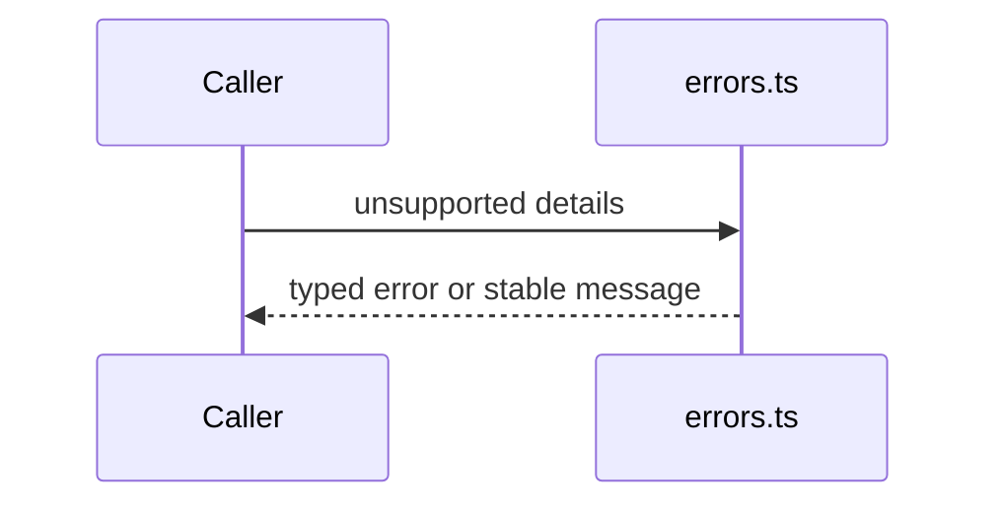

# src/canonical/nfe/errors.ts

## Visao geral

Define os erros base e as mensagens estaveis do slice operacional de NFe.

## Responsabilidades

- Padronizar erros de uso incorreto.
- Padronizar erros de escopo fora do MVP.
- Gerar mensagens publicas reprodutiveis para validacoes operacionais.

## Entradas e saidas

- Entradas: detalhes normalizados de ambiente e operacao.
- Saidas: instancias de erro e mensagens publicas estaveis.

## Fluxo principal



## Tratamento de erros e casos-limite

- As mensagens mantem linguagem estavel para testes de contrato.
- O arquivo nao conhece regras especificas de transporte nem de assinatura.

## Exemplos

```ts
import { createUnsupportedOperationalScopeMessage } from './errors.js';
```

## Dependencias e integracoes

- `contracts.ts`
- Facades operacionais futuras