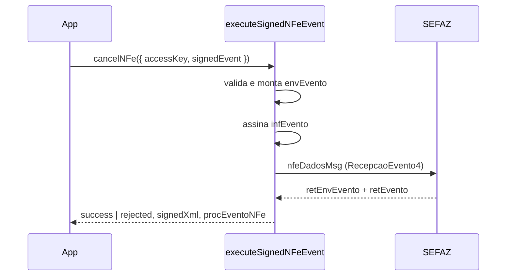

# nfe-signed-event

## Visão geral

Monta, assina, envia e classifica os eventos reais da NF-e no envelope oficial: cancelamento (`110111`), carta de correção (`110110`) e inutilização (`inutNFe` 4.00). É acionado pelos facades `cancelNFe`, `submitNFeCorrectionLetter` e `submitNFeInutilization` quando a entrada traz `signedEvent`; sem `signedEvent` vale o comportamento antigo (corpo plano, só homologação).

## Responsabilidades

- Validar antes de assinar ou enviar: chave de 44 dígitos, CNPJ/CPF, data/hora com fuso, sequência 1–99, justificativa de cancelamento (15–255 caracteres, sem espaços nas pontas) e protocolo de 15 dígitos, texto da carta (15–1000), faixa de inutilização (início ≥ 1, fim ≥ início, no máximo 10.000 números, série 0–999).
- Montar `envEvento/evento/infEvento/detEvento` com `Id` = `ID` + `tpEvento` + chave + sequência (2 dígitos) e `inutNFe/infInut` com `Id` = `ID` + cUF + ano + CNPJ + modelo + série (3) + números (9 + 9).
- Assinar (`signEventXml`, `signInutilizationXml`) e enviar pelo envelope SOAP `nfeDadosMsg` (`NFeRecepcaoEvento4` / `NFeInutilizacao4`).
- Classificar pelo protocolo: evento registrado com `cStat` 135, 136 ou 155; inutilização homologada com 102; qualquer outro vira `rejected` com o motivo oficial.
- Devolver `signedXml` e, quando registrado, `authorizedXml` (`procEventoNFe` ou `ProcInutNFe`).

## Entradas e saídas

Entrada: `OperationalMaintenanceRequest` com `accessKey` (eventos), `environment`, `signedEvent` (`NFeSignedEventDetails`), `requestExecutor` e `timeoutMs`. Saída: `OperationalMaintenanceOutcome` com `classification`, `applicationStatusCode`, `protocolNumber`, `signedXml`, `authorizedXml`.

## Fluxo principal



## Tratamento de erros e casos-limite

- Entrada inválida: `usage-error` sem assinar nem enviar.
- Produção: exige UF 35 na chave (ou `cUF` da inutilização) e `requestExecutor` com TLS mútuo; fora de SP é `unsupported-scope`.
- Timeout ou indisponibilidade mantêm a classificação do transporte e não viram "registrado".

## Exemplos

```ts
const outcome = await cancelNFe({
  accessKey,
  canonicalPayload: {},
  environment: 'production',
  requestExecutor,
  signedEvent: { eventDateTime, issuerTaxId, justification, protocol, signingContext },
});
```

## Dependências e integrações

`signEventXml`, `signInutilizationXml`, `executeNFeSoapService` (`wireFormat`), `resolveIssuerAuthorizer` (SP quando a UF é 35) e `mapOperationalMaintenanceTransportOutcome`.
