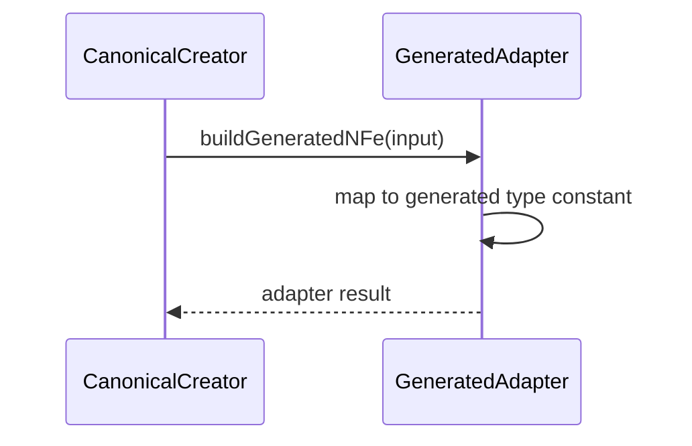

# src/canonical/nfe/generated-nfe-adapter.ts

## Visao geral

Converte entradas canonicas da facade em marcadores estaveis de proveniencia gerada, sem depender da arvore gerada em runtime.

## Responsabilidades

- Expor discriminadores estaveis equivalentes aos tipos gerados de `NFe` e `enviNFe`.
- Preservar a proveniencia normativa sem acoplar o runtime publicado a imports da arvore gerada.
- Manter a arvore gerada fora da superficie publica principal.

## Entradas e saidas

- Entradas: `CanonicalNFeInput`, `CanonicalEnviNFeInput` e versao normalizada.
- Saidas: nomes de tipo usados internamente como evidencia de proveniencia.

## API / Assinatura

```ts
export function buildGeneratedNFe(input: CanonicalNFeInput): GeneratedNFeAdapterResult;
export function buildGeneratedEnviNFe(
  input: CanonicalEnviNFeInput,
  version: CanonicalVersion,
): GeneratedEnviNFeAdapterResult;
```

## Fluxo principal



## Tratamento de erros e casos-limite

- Assume que as entradas obrigatorias ja foram normalizadas antes da adaptacao.
- Nao instancia classes geradas durante o runtime publicado.

## Exemplos

```ts
const generated = buildGeneratedNFe({
  documentId: 'NFe001',
  environment: 'homologation',
  version: '4.00',
});
```

## Dependencias e integracoes

- `../shared/contracts`