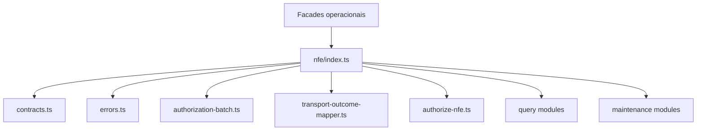

# src/canonical/nfe/index.ts

## Visao geral

Agrupa os contratos, erros e helpers internos que sustentam o slice operacional de NFe.

## Responsabilidades

- Reexportar os tipos estruturados do MVP operacional.
- Reexportar os erros base do dominio operacional.
- Reexportar os helpers compartilhados de lote e de mapeamento de transporte.
- Reexportar a orquestracao e os mapeadores iniciais de autorizacao.
- Reexportar a orquestracao e os mapeadores iniciais de consulta.
- Reexportar a orquestracao e o mapeamento compartilhado das manutencoes homologadas.

## Entradas e saidas

- Entradas: nenhuma.
- Saidas: contratos, erros e helpers usados pela camada operacional.

## Fluxo principal



## Tratamento de erros e casos-limite

- O barrel nao executa validacoes.
- Os erros e regras de mapeamento ficam encapsulados nos modulos reexportados.

## Exemplos

```ts
import {
  authorizeNFe,
  buildNFeAuthorizationBatch,
  cancelNFe,
  mapTransportOutcomeToAuthorizationClassification,
  submitNFeCorrectionLetter,
  submitNFeInutilization,
} from './index.js';
```

## Dependencias e integracoes

- `./authorization-batch.js`
- `./authorization-outcome.js`
- `./authorization-payload.js`
- `./authorize-nfe.js`
- `./cancel-nfe.js`
- `./contracts.js`
- `./errors.js`
- `./maintenance-outcome.js`
- `./query-nfe-document-situation.js`
- `./query-nfe-service-status.js`
- `./submit-nfe-correction-letter.js`
- `./submit-nfe-inutilization.js`
- `./transport-outcome-mapper.js`