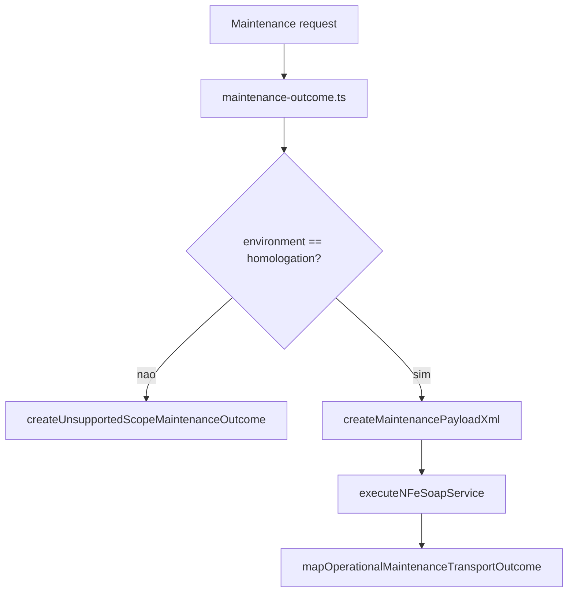

# src/canonical/nfe/maintenance-outcome.ts

## Visao geral

Centraliza a orquestracao compartilhada das manutencoes operacionais do MVP de NFe.

## Responsabilidades

- Traduzir `TransportOutcome` em `OperationalMaintenanceOutcome`.
- Montar o payload XML minimo para inutilizacao, cancelamento e carta de correcao.
- Devolver uma boundary estruturada de `unsupported-scope` sem depender do transporte.
- Reaproveitar a taxonomia do slice de transporte sem criar uma segunda linguagem de falhas.

## Entradas e saidas

- Entradas: `OperationalMaintenanceRequest` ou `OperationalMaintenanceFacadeInput`.
- Saidas: `OperationalMaintenanceOutcome`.

## Fluxo principal



## Tratamento de erros e casos-limite

- Ambientes fora de `homologation` devolvem `unsupported-scope` de forma estruturada.
- O protocolo e extraido de `nProt` quando o XML de resposta o expuser.
- A classificacao operacional reaproveita o mapeador compartilhado do transporte.

## Exemplos

```ts
import { executeOperationalMaintenanceOperation } from './maintenance-outcome.js';
```

## Dependencias e integracoes

- `../transport/execute-nfe-soap-service.js`
- `./contracts.js`
- `./errors.js`
- `./transport-outcome-mapper.js`
