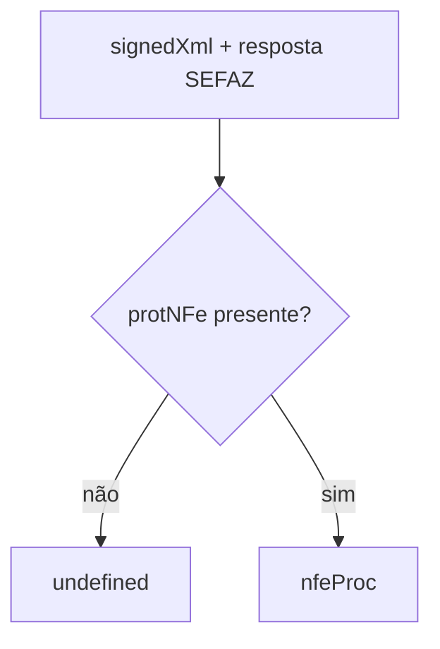

# protocol-matches-signed-nfe

## Visão geral

Confere se o `digVal` do `protNFe` é igual ao `DigestValue` da NFe assinada.

## Responsabilidades

Função pura, sem I/O, usada pela autorização de documento construído e pela consulta de situação (`signedXml`).

## Entradas e saídas

Strings XML; retorno em string, `undefined` (sem `protNFe`) ou booleano.

## Fluxo principal



## Tratamento de erros e casos-limite

Não lança exceções; entrada sem o elemento esperado resulta em `undefined`/`false`.

## Exemplos

```ts
assembleNfeProc(signedXml, responseXml);
```

## Dependências e integrações

Consumido por [authorize-built-document.ts](authorize-built-document.ts) e [queries/wire-document-situation.ts](queries/wire-document-situation.ts).
