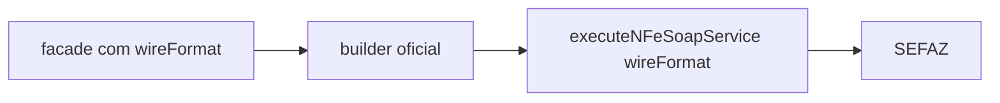

# nfe-query-payloads

## Visão geral

Construtores dos corpos oficiais das consultas: `consStatServ` (4.00), `consSitNFe` (4.00), e `distDFeInt` (1.01). `consReciNFe` fica em `async-batch-retrieval.ts`. Todos levam o namespace `http://www.portalfiscal.inf.br/nfe` e são validados pelos XSD oficiais nos testes.

## Responsabilidades

Montar o XML exato (sem declaração) com `tpAmb` (1 produção, 2 homologação), recusando valores malformados: `cUF` de 2 dígitos, chave de 44 dígitos, CNPJ (14) ou CPF (11), `ultNSU`/NSU de 15 dígitos.

## Entradas e saídas

```ts
buildConsStatServXml(environment, cUF): string
buildConsSitNFeXml(environment, accessKey): string
buildDistDFeIntXml(environment, authorUF, taxId, { ultNSU } | { nsu } | { accessKey }): string
```

## Fluxo principal



## Tratamento de erros e casos-limite

Os builders lançam `Error`; os facades convertem em `usage-error` antes de qualquer chamada. A distribuição aceita um seletor por vez (`distNSU`, `consNSU` ou `consChNFe`).

## Exemplos

`buildDistDFeIntXml('production', '35', '11222333000181', { ultNSU: '000000000000000' })`.

## Dependências e integrações

Usado por `queryWireServiceStatus`, `queryWireDocumentSituation` e `distributeRecipientDFeWire`.
